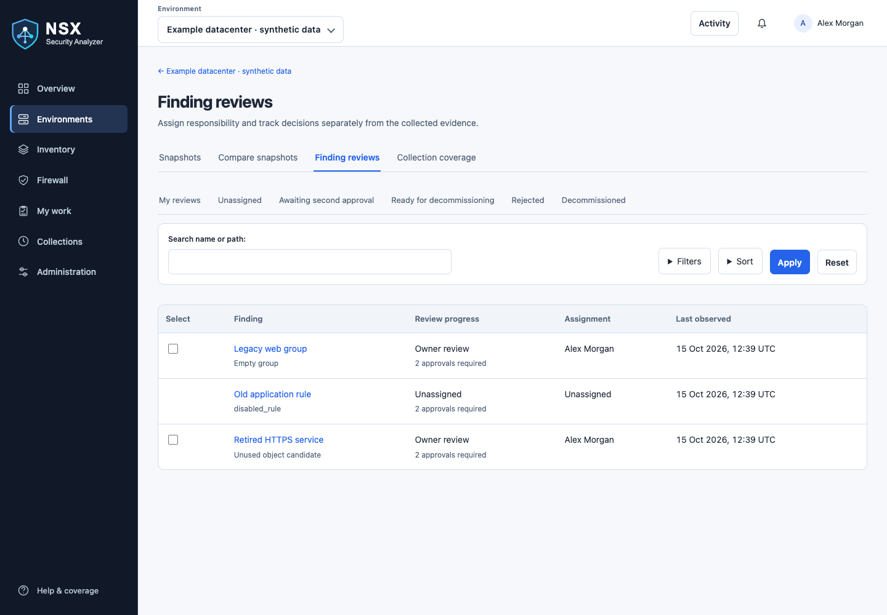

<picture>
  <source media="(prefers-color-scheme: dark)" srcset="webapp/static/nsx-security-analyzer-logo.svg">
  
</picture>

# NSX Security Analyzer

> **Release 0.5.3** includes compact review actions, returning assignments to
> unassigned, and independent collection, finding recalculation and comparison lanes.
> Deploy matching images for web, worker, scheduler and migrations. Stop old worker
> replicas before starting the new workers; apply all pending migrations first.
> The `development` branch and image add newer work; see the Unreleased section of
> the [changelog](CHANGELOG.md).


An NSX Policy inventory and security review workspace with read-only collection and explicitly confirmed administrator deletion of approved objects. Collect inventory
from multiple NSX Managers, explore firewall rules and reference evidence, and
compare saved snapshots in a PostgreSQL-backed web application.


**Findings are review candidates, not deletion approvals or proof of historical non-use.**
The collector sends GET requests to NSX; it does not change rules or reset counters.

## What it does



*Finding reviews in the current interface, using synthetic data.* See the
[visual walkthrough](docs/screenshots.md) for assignment, comparison and coverage examples.


- Inventory VMs, groups, services, distributed firewall policies, rules, tags and scopes.
- Explore VM tags and related groups, firewall rules and configured services; relationships are configuration evidence, not verified membership or traffic.
- Identify empty groups, unreferenced custom objects, disabled rules and zero recorded counters.
- Inspect membership definitions, configuration references and collection coverage.
- Schedule collections per environment, with progress tracking and readable errors.
- Retain snapshots in PostgreSQL and review firewall activity across observations.
- Compare snapshots, assign finding owners and reviews, and inspect observation gaps.
- Search tables with AND/OR or regex, apply column filters, and export matching rows as CSV.
- Manage users, retention, sync policies, display preferences and notifications.
- Explore synthetic data in a separate demo environment without connecting to NSX.

The web application supports bundled or customer-managed PostgreSQL. Configure
environments, schedule collections and explore reports through the web interface.

## Installation

**Recommended: [install the complete Docker Compose stack from Docker Hub](docs/docker-hub.md)** — no source checkout, local build or install.sh required.
Images are available for AMD64 and ARM64 at [Docker Hub](https://hub.docker.com/r/vkernel/nsx-security-analyzer).

Choose one installation path:

| Deployment | Guide | When to choose it |
| --- | --- | --- |
| Docker Hub + Compose | [Step-by-step installation](docs/docker-hub.md) | Easiest way to run the published release |
| Docker Compose from source | [Source setup](webapp/README.md#run-from-source-with-docker-desktop) | Test changes not published to Docker Hub yet |
| Kubernetes | [Step-by-step installation](deploy/kubernetes/README.md) | Run on an existing Kubernetes platform |
| Kubernetes with Argo CD | [GitOps deployment and upgrades](deploy/kubernetes/README.md#argo-cd-deployment-and-upgrades) | Run migrations before application rollouts using sync hooks |

Docker Hub's Run button starts a single container. **Compose or Kubernetes must
also start PostgreSQL, database migrations, the worker and the scheduler.** The
provided deployment files include these components. The migration container exits
successfully after initialization; this is expected.

Release **0.5.3** includes configurable finding approvals, compact review controls,
independent background task queues, improved inventory verification, Keycloak/LDAPS
authentication and updated operating guidance.

## Quick start from source

Requirements: Docker with Docker Compose and access to your NSX Manager's HTTPS
Policy API. The remote-database override requires Compose 2.24.4 or later.

```sh
git clone https://github.com/vkernel/NSX-Security-Analyzer.git
cd NSX-Security-Analyzer/webapp
cp .env.example .env
chmod 600 .env
```

Generate two independent secrets, running this command once for each:

```sh
python3 -c 'import secrets; print(secrets.token_hex(32))'
```

Set `DJANGO_SECRET_KEY` and `POSTGRES_PASSWORD` in `.env`, then start:

```sh
docker compose up --build -d
```

On a fresh source deployment, database initialization creates username **`admin`**
with password **`NSXSecurityA!`**. The application requires you to replace this initial password immediately after signing in. Existing administrators are left unchanged.
No manual account-creation command is needed.

Open **http://localhost:8000** and sign in. In **Administration**, add an
environment with its NSX Manager address, username and password. Retrieve and review its certificate if required and select a sync interval. Use **Test credentials** before saving to verify the entered account and TLS settings with a read-only Policy API request. Testing does not save credentials or change the collection schedule. It verifies basic read access, not all collection or deletion permissions. When changing the account or Manager, enter its password; a blank password can test the saved credential only for the unchanged account and Manager. You can also run a collection
from the environment page. For a preview, choose **Environments → Add environment → Create demo environment**.

Keep `DJANGO_SECRET_KEY` stable: it is used to protect saved manager credentials.
The default service listens on loopback. Use an HTTPS reverse proxy for shared access.

## Documentation

| Guide | Contents |
| --- | --- |
| [Docker Hub installation](docs/docker-hub.md) | Prebuilt images, Compose setup and upgrades |
| [Kubernetes installation](deploy/kubernetes/README.md) | Manifests, migration Job and worker lanes |
| [Installation and configuration](webapp/README.md) | Source build, external PostgreSQL, TLS, users, scheduling and settings |
| [Keycloak](docs/keycloak.md) and [LDAPS](docs/ldaps.md) | Optional authentication providers |
| [Operations](docs/operations.md) | Upgrades, worker lanes, backups, recovery, deletion limits and troubleshooting |
| [Resource sizing](docs/resource-sizing.md) | Small, medium and large deployments |
| [Collection performance](docs/collection-performance.md) | Request pacing, concurrency and diagnostics |
| [Snapshot maintenance](docs/snapshot-maintenance.md) | Refresh jobs and stopping collections |
| [Reviews and deletion](docs/finding-review-workflow.md) | Finding reviews, approvals, reference cleanup and NSX deletion |
| [History and comparison](docs/history-and-review.md) | Snapshot comparison, review history and coverage |
| [Reference exports](docs/reference-exports.md) | Exporting object references (CSV, PDF, JSON, YAML, HTML) |
| [Segmentation](docs/segmentation.md) | Application segmentation and VM-to-VM investigation |
| [Naming policies](docs/naming-policies.md) | Group naming components and proposals |
| [Architecture](docs/architecture.md) | Components, storage and collection flow |
| [UI patterns](docs/ui-patterns.md) and [workspace performance](docs/workspace-performance.md) | Interface conventions and browsing performance |
| [Screenshots](docs/screenshots.md) | Visual walkthrough with synthetic data |
| [Contributing](CONTRIBUTING.md) | Development setup, PostgreSQL tests and pull requests |
| [Claude Code handover](docs/claude-code-handover.md) | Published baseline, evidence semantics and continuation checklist |
| [Security](SECURITY.md) and [Support](SUPPORT.md) | Vulnerability reporting, deployment boundaries and diagnostics |
| [Roadmap](roadmap.md) and [Changelog](CHANGELOG.md) | Planned work and project changes |

Dated files under [docs/design](docs/design/README.md) are historical design records.

## Scope and interpretation

The collector targets **NSX Local Manager `/infra` Policy inventory**. It does not
provide NSX-V, legacy Manager, Global Manager or project inventory coverage.
Use an account with read access across Policy inventory and search.

Search indexing delays and account visibility affect reference findings. Missing
or failed counter checks are unknown, not zero. Historical analysis compares
saved observations; collection gaps, counter resets and activity between snapshots
limit what can be concluded. A segmentation indicator describes rule configuration,
not effective workload isolation. Read coverage and evidence before acting.

All signed-in workspace users can read all environments; this is not tenant
isolation. Local accounts, Keycloak and verified LDAPS authentication are supported.
External role mappings use the same Viewer, Operator and Administrator permissions.

## Project status and license

Versioned releases are listed on GitHub and Docker Hub. No support SLA is offered.
Validate the application against your NSX deployment before operational adoption.

NSX Security Analyzer is licensed under the [Apache License 2.0](LICENSE).
See [NOTICE](NOTICE) for project attribution. Third-party dependencies retain their
own licenses; the project license does not replace their terms.

This is an independent project and is not affiliated with or endorsed by VMware
or Broadcom.

## Naming standards

Use [Group naming policies and component proposals](docs/naming-policies.md) to compose names from ordered definition scopes and reviewed values, distinguish dynamic/static/mixed groups, and preview environment-specific rules.
