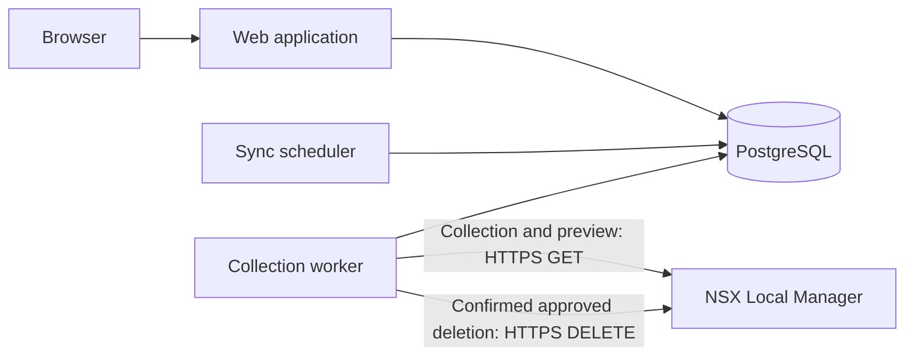

# Architecture

The web process handles authentication, environment configuration, queued collection
requests and report rendering. It does not wait for a live NSX collection during
a page request. PostgreSQL stores accounts, settings, collection jobs and snapshots;
report data is stored as JSONB. The viewer renders from that saved data. Legacy HTML
storage remains for database compatibility and is not used by the viewer.

The scheduler checks enabled environments and their sync intervals. The worker
supervises three independent lanes: collection, finding-history recalculation and
snapshot comparison. PostgreSQL advisory leases allow one task of each type
globally across replicas. Collection calls NSX, updates progress and saves a snapshot;
the other lanes use saved database evidence. Same-environment publication briefly
serializes on a database lock. All subprocesses share the worker container resources.
A conditional database constraint prevents two active collections for one environment.
Job configuration captures the environment settings at queue time. Collection
concurrency adapts internally; it is not an environment form setting.

The shared collector reads inventory and search references, checks membership and
retrieves counters. Failed or incomplete checks retain uncertainty. History analysis
uses saved observations and identity checks; it cannot reconstruct unseen traffic.

The web workspace stores snapshots in the database. There is no standalone collector
command, file-based report workflow or JSON report import. Deployment and internal
worker management commands are operational tooling, not alternative product interfaces.

## Layout

- `webapp/inventory/collector.py`: internal collector and report renderer.
- `test_collector.py`: offline collector and generated JavaScript tests.
- `webapp/config/`: application configuration and URL setup.
- `webapp/inventory/`: models, migrations, jobs, views, forms and tests.
- `webapp/templates/`, `webapp/static/`: integrated UI.
- `webapp/compose*.yaml`: source development and existing Hub/remote overrides.
- `deploy/compose.yaml`: complete prebuilt Docker Hub stack.
- `deploy/kubernetes/manifests/`: native Kubernetes installation files.
- `deploy/kubernetes/compose.yaml`: optional converter template only.
- `docs/`: product and operating references.

Tests and historical migrations are required project files: tests validate behavior,
and migration history allows existing databases to upgrade safely. Generated Python
bytecode is disposable. Private deployment files and backups are ignored by Git
and excluded from Docker builds; they are not part of the distributed application.

Administrator deletion requests are stored as batches with per-object evidence and
outcomes. Read-only previews run in a separate lane; confirmed execution uses its own exclusive lane. The
worker revalidates approvals and live evidence before each DELETE, never retries a
DELETE automatically, and records uncertain outcomes separately. See the
[workflow](finding-review-workflow.md#delete-approved-objects-from-nsx).
