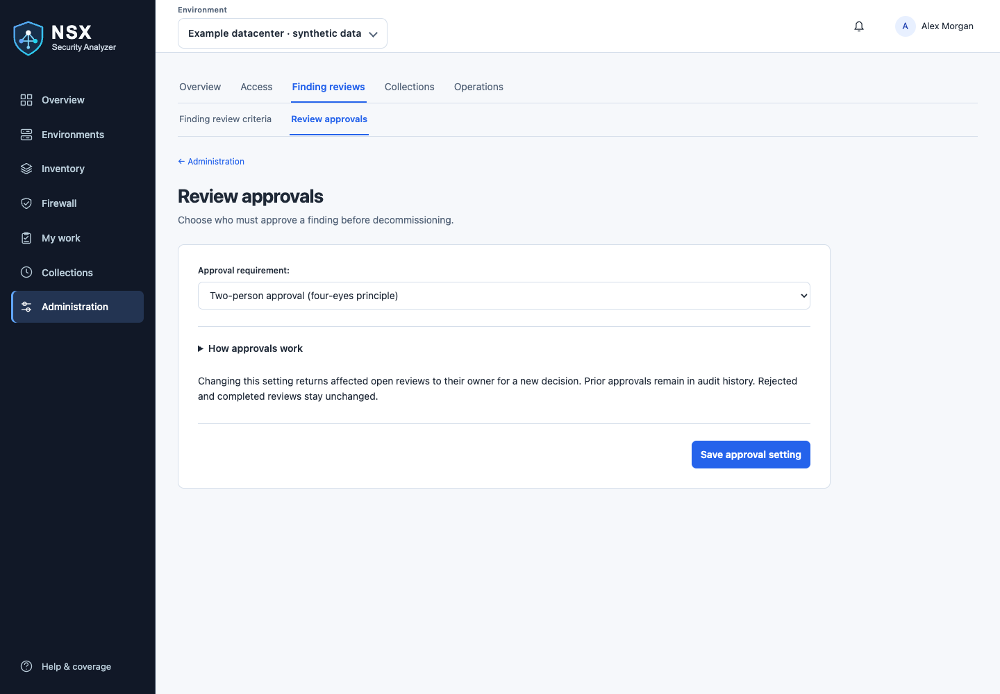
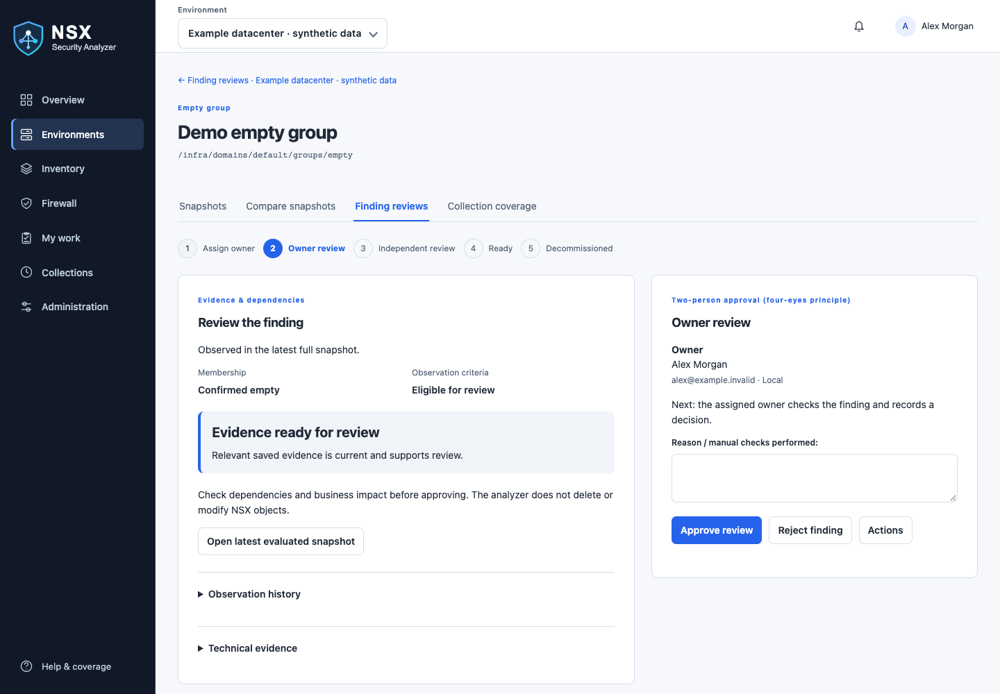
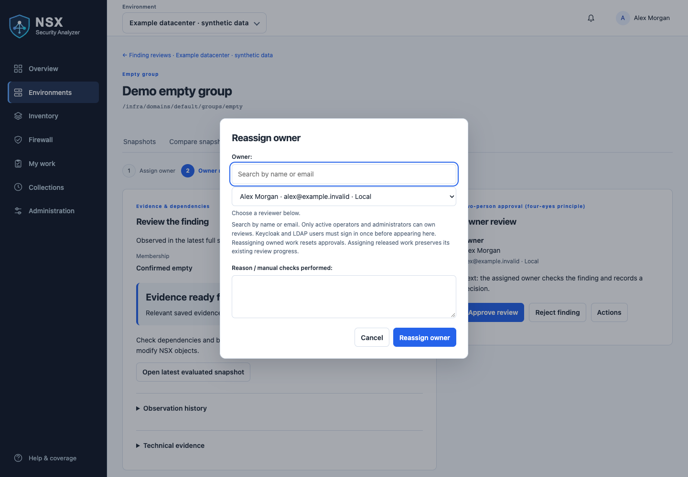
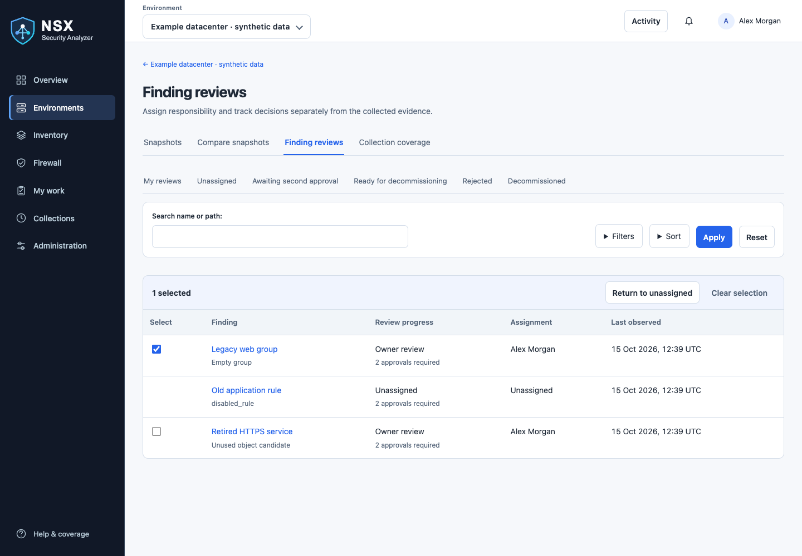
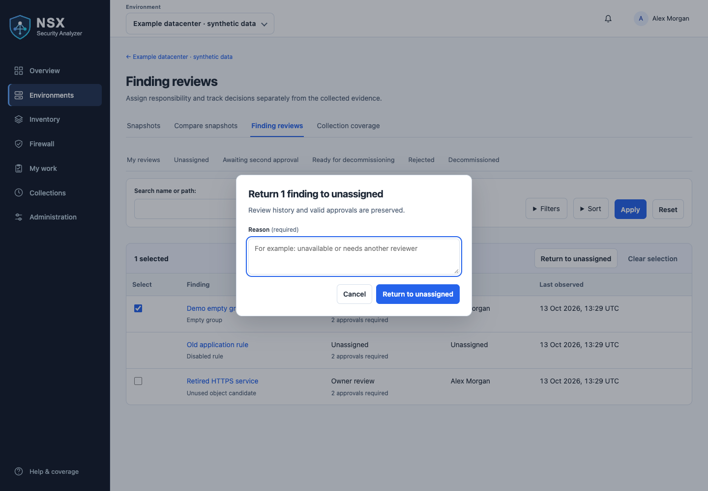
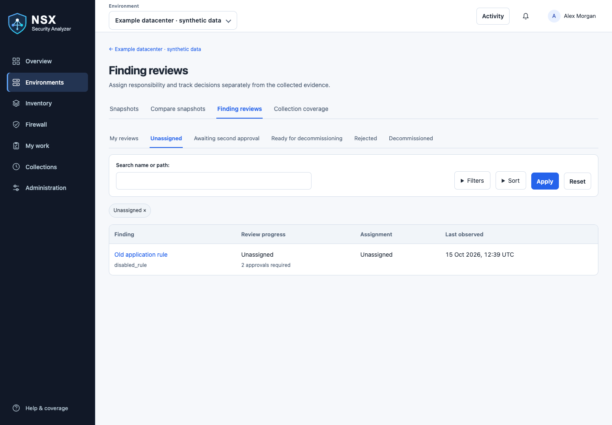

# Finding review approvals

Finding reviews authorize a proposed decommissioning decision. Approval alone does
not modify NSX. A separate administrator preview and explicit confirmation can delete
supported approved objects. Operators and administrators can perform review workflow
actions; viewers can read the results. The same rules apply to local, Keycloak
and LDAP accounts. Each person must use their own account.

## Reading observation badges

A badge such as **zero hits: Eligible for review** describes whether the finding
meets the configured evidence requirements. The line below it shows **complete
observed days / required days · successful observations**.

| Example | Meaning |
|---|---|
| **zero hits: Eligible for review — 8 / 7 days · 192 observations** | The current qualifying sequence spans 8 complete days, exceeding the required 7 days. Its 192 successful checks also satisfy the configured minimum observation count. The finding can enter review. |
| **zero hits: Observing — 0 / 7 days · 19 observations** | There are 19 qualifying checks, but less than 24 hours between the first and latest checks in the current sequence. The day count rounds down to 0; the required 7 days have not elapsed. |

**Observations are checks, not traffic hits.** Each qualifying zero-hit check
supports the zero-counter condition. Many checks in one day cannot replace a
seven-day observation period: both elapsed time and the minimum count must be met.
Seven days means at least 168 hours between qualifying snapshots. Time after the
latest snapshot does not count; waiting without further collections does not
advance the assessment.

Relevant rule changes or excessive collection gaps restart the period. Missing,
unknown or opposite evidence interrupts continuity. A low day count alone does
not tell you which of these happened. Open the finding's **Observation history**
for the period start, last observation and qualification explanation. Historical
report badges reflect the assessment saved with that snapshot.

**Eligible for review is not approval to delete.** Review the rule's purpose,
dependencies and evidence before making a decision. Zero recorded counters do not
prove that no traffic occurred between checks. Configure the required period in
**Administration → Finding review criteria**; environment overrides take precedence
over global defaults.

While criteria recalculation is queued, running or failed, affected finding types
cannot receive first or second approval or record decommissioning completion.
Previously saved eligibility is not sufficient during this interval. Unaffected
finding types remain reviewable, and rejection remains available. If recalculation
fails, an administrator must save the criteria again and wait for successful
completion; the recalculated finding must still satisfy normal evidence checks.

## Configure the approval requirement

*Synthetic administrator view. The effect on open reviews remains visible beside the setting.*

Open **Administration → Review approvals** to choose the workspace default and
optional overrides for groups, custom services, firewall rules and firewall policies.
Only administrators can change these settings. Four-eyes remains the default;
overrides initially inherit it. Use **Preview changes** before saving to see affected
open reviews. Only reviews whose effective requirement changes lose their current
approvals; ownership and historical decisions remain. Rejected and completed reviews
are unchanged. See [approval modes by category](#approval-modes-by-category).

With single approval, the assigned owner's approval moves the finding directly
to **Ready for decommissioning**. All evidence checks and manual verification
requirements still apply. Record completion with a change ticket as described
below. Approval requirements and decisions are retained in the audit history.

## Two-person workflow (default)

1. Open an eligible finding and choose **Assign owner**. Select an active operator
   or administrator. No reason is required to assign an unassigned finding. The finding enters **Owner review**.
2. The owner manually checks dependencies, coverage and change impact. Choose
   **Approve review** or **Reject finding** and describe the checks and decision.
3. An approval enters **Awaiting second approval**. A different operator or
   administrator performs an independent review. The owner cannot give this
   approval, even with administrator access.
4. Second approval moves the finding to **Ready for decommissioning**. Perform
   the actual change through your organization's change process, or use the
   [administrator deletion workflow](#delete-approved-objects-from-nsx).
5. For an externally performed change, choose **Record decommissioning**, enter the mandatory change-ticket reference
   and completion reason. This records a manual attestation, not automated proof
   of deletion. Record completion before a new collection removes the condition;
   otherwise its approval is invalidated and it must be reviewed again.

A rejection ends the current review. **Reopen review** starts a new owner review
with a mandatory explanation. Reassigning to another owner also clears approvals.
Existing Open/Acknowledged records are migrated to Unassigned or Owner review
according to their owner; old acknowledgements never count as approvals.

## Evidence and validity

Every required approval requires an eligible, currently observed finding from the latest
full, non-testing, non-imported snapshot. The snapshot must be within the shared
freshness threshold (Administration → Freshness & notifications). Approval checks
use the selected object's saved indexed evidence:

| Finding | Required evidence |
| --- | --- |
| Empty group | Membership successfully confirmed empty |
| Zero-hit rule | Fresh zero counters with successful zero-hit status; no disabled rule |
| Unused object | Unused candidate with unrestricted search, or successful compatibility search plus independent manual verification by each required reviewer |
| Disabled rule | Explicitly confirmed disabled state |
| Empty policy | Successful empty status and exactly zero rules |

Missing indexed object evidence, exclusions, unknown or contradictory values block
approval with a specific explanation. Unrecorded or failed search blocks unused-object approvals. Successful compatibility
search permits a documented manual verification route: each reviewer must confirm
an independent dependency check, describe the systems and dependencies checked
outside the collected search scope, and provide a ticket or evidence reference.
The first reviewer’s confirmation never substitutes for the second person’s check.
Coverage remains limited; approval does not relabel it as complete. Search
remains eventually consistent and visibility depends on permissions; unrestricted
search is not proof that every possible dependency is visible.

Inventory verification warnings pause findings that require the affected evidence.
Dedicated VM inventory warnings pause empty-group and tag-dependent checks; unrelated
service and firewall findings can continue only with complete required evidence.
Unknown endpoint scopes and configuration inventory/search inconsistencies remain
blocking. Temporary inventory uncertainty preserves decisions and observations;
verified relevant configuration changes still invalidate approvals. The queue shows
**Verification paused — decisions retained** or **Approved — execution verification required**.
Historical recalculation also skips affected observations without counting them as
successful checks. Observation thresholds, freshness and maximum-gap rules still apply.

Each approval retains the actor identity, timestamp, reason, source snapshot UUID,
relevant evidence fingerprint, evidence, reference-search scope and any manual
verification description and evidence reference. A changed reference-search scope
requires a new owner review. A routine collection with unchanged
relevant evidence preserves the approvals. Relevant changes, a disappeared
condition, incomplete evidence relevant to the finding or criteria recalculation that removes
eligibility invalidate pending approvals. The owner must review again. Stale data
blocks final approval and completion until a fresh full collection is available.

## Queues, notifications and audit

Use **My reviews**, **Unassigned**, **Awaiting second approval**, **Ready for decommissioning**,
**Rejected** and **Decommissioned** above the filters. Status sorting uses workflow
stage. Assigned findings remain visible if their evidence stops qualifying, so the
owner can see why a new collection or review is needed. Rejected and completed decisions remain available even if the condition
later disappears. Direct finding URLs retain the full history.

The notification bell includes assignments for the owner and second approvals for
other operators/administrators. Turn these off with the personal **Finding
assignments and second approvals** setting. This setting applies independently of
collection notification overrides. Marking notifications read does not dismiss
pending work from the review queues.

Each assignment, decision, reset and completion writes a review-history event and
an application audit event in the same transaction as the action. Conflicting
edits are rejected; reload the page to see the current decision. Failed workflow
actions are recorded in the application audit log. **Export audit history (JSON)**
includes the saved decisions and their evidence. Review history survives snapshot
retention and retains actor names after user deletion. An environment with deletion records cannot be deleted because those records are
protected. Otherwise deleting an environment also deletes its finding history; application audit events follow their separate
audit retention policy. Export records before deleting an environment when longer
retention is required.

Deploy the application migrations before starting the updated web and worker
containers. No new service or scheduled task is required.

## Click-by-click example with Keycloak users

### Prepare the two reviewers

Have both people sign in to NSX Security Analyzer using **Sign in with Keycloak**
at least once. Their Keycloak role mappings must grant the application **Operator**
or **Administrator** role. Viewer accounts cannot be assigned or approve findings.
The owner selector searches users already provisioned in this application, not the
entire Keycloak directory. It displays **Name · email · Keycloak**. LDAP and local
accounts show their corresponding provider. If names or email are missing, correct
the identity-provider profile/claims and sign in again to refresh the profile.

### 1. Assign the finding

1. Open **Environments**, select your environment, then click **Finding reviews**.
2. Click the finding's name to open its detail page.
3. Choose **Assign owner** directly when it is the only available action; otherwise
   use **Actions → Assign owner** (or **Reassign owner**).
4. Search by name or email in the single **Owner** field and select a suggestion.
   Typing new text clears the prior selection; select a matching reviewer before submitting.
   You can use the arrow keys and Enter to select a result.
5. Click **Assign owner**. No reason is required for an unassigned finding, including
   released work. Reassigning already-owned work still requires a reason and resets
   approvals. Assignment is recorded in the audit history with the actor and new owner.

### 2. Owner performs the first review

1. The assigned owner signs in and opens **Finding reviews → My reviews**, or uses
   the assignment notification in the notification bell.
2. Open the finding. Use **Open latest evaluated snapshot** and **Technical evidence
   → Load saved technical evidence** to inspect the relevant information.
   Check dependencies and business requirements manually.
3. Read the readiness banner. Write your reasoning in **Reason / manual checks
   performed**. If manual verification is required, complete the confirmation,
   dependency-check description and evidence reference. Click **Approve review**
   or **Reject finding**. Rejection does not require the approval confirmation.
4. Approval moves it to **Awaiting second approval**. Rejection moves it to
   **Rejected**, retaining the reason in history.

### 3. Another person performs the independent review

1. A different Operator or Administrator signs in.
2. Open the environment's **Finding reviews → Awaiting second approval**, or open
   its review notification. Select the finding.
3. Read the owner approval and inspect the evidence independently.
4. Enter a reason and, where required, your own independent verification details.
   Click **Approve review** or **Reject finding**.
   The owner cannot provide this approval, including when the owner is an admin.
5. Second approval moves the finding to **Ready for decommissioning**. This is a
   decision recorded in the analyzer; no object is deleted automatically.

### 4. Perform and record the change

1. Open **Finding reviews → Ready for decommissioning** and select the finding.
2. Execute the actual change using your normal change-management process.
3. The decision panel now shows **Change-ticket reference**. Enter your ticket identifier and describe what was done in
   **Reason / manual checks performed**.
4. Click **Record decommissioning**. The finding becomes **Decommissioned**. Record this
   promptly, before a new collection removes the condition and invalidates the
   pending approval. Approval/completion guards described above still apply.

### 5. Inspect the audit trail

Scroll to **Review history** on the finding page. It shows the actor, time and
action and its reason where required. Assignment without a note is recorded as “Owner assigned.” Operators and administrators can click **Export audit
history (JSON)** to download the decisions with saved evidence and stable actor
IDs. Names are for display; changing a name or email cannot bypass the different-
approver check. Existing historical identity values are preserved in the export;
the page resolves older internal Keycloak identifiers to readable names when the
account still exists.

The searchable owner selector is in the **Assign owner** dialog (under **Actions** when multiple actions are available). **Change-ticket reference**
appears only when recording completion. To change notification preferences, open your user menu →
**Personal settings → Notifications** and change **Finding assignments and second
approvals**.

## Reading the review page

Screenshots show version 0.5.3 with synthetic documentation data. Names, counts and timestamps are illustrative; available actions depend on your role and review state.

*Evidence and readiness stay beside the decision panel. Use Actions for ownership changes.*

*Reassign owner opens a focused dialog with one searchable user selector. Reassigning owned work resets approvals; assigning released work preserves valid progress.*

The progress indicator shows the current stage. Evidence and dependencies appear
on the left; the owner, next action and decision controls appear on the right
(or below on smaller screens). Observation criteria being met does not mean
approval is permitted: the readiness banner separately identifies missing evidence
or required manual verification before submission. Technical evidence and detailed
observation dates are expandable. Validation errors preserve entered notes.

Owner and second approvals show their reasons and independent verification
records. Review history is a chronological activity list with actor names and
timestamps; use the JSON export for the complete retained decision records.

## Daily review queue

Open **My work** in the main menu to see tasks across environments:

- **Assigned to me** contains your owner reviews.
- **Available for second approval** excludes your own first approvals.
- **Ready for decommissioning** contains approved findings awaiting a recorded change.

The findings list shows whether each review requires one or two approvals. To assign
an owner, choose **Assign owner**, search by name or email and select a result.
No reason is required for assigning unassigned work. Search returns up to 20 active operators/administrators; refine your
search for more specific matches. External users still need to sign in once before
they can be selected. A second approval remains available to another eligible reviewer;
it does not require reassigning the owner.

Administration uses fixed category tabs: Access, Finding reviews, Collections, and
Operations. A second row shows the pages in the selected category. Open Finding reviews to change criteria or approval settings.

## Navigation and review feedback

Administration Overview is a settings directory. Open **Collections → Environments &
sync** for schedules; **Freshness & notifications** has the same name throughout the
application. Environment analysis tabs highlight the current page, including Snapshots.
Reviewer assignment uses one server-side search by name or email.

A review queue distinguishes no eligible findings from no filter matches, and offers
Clear filters for the latter. Comparisons show Queued, Preparing, Failed (with Retry),
or Ready. Recent collections use aligned columns on desktop and labelled cards on
mobile, retaining progress updates and stop controls for active collections.

### Returning assigned work to the queue

*Select an eligible row to reveal the action bar. Selection applies to this page.*

*Enter the shared reason, then submit. Cancel keeps the rows selected without changing assignments.*

*The Unassigned queue has no release checkboxes. Open a finding to assign an owner.*

Operators can use **Return to unassigned** on their own finding reviews;
administrators can release anyone's assignment. A reason is required and the
history records the actor, previous owner and reason. The **Unassigned** queue
filters by owner, independently of the preserved review stage. Ownerless findings
are excluded from Awaiting second approval and Ready for decommissioning queues,
including My work. They show “Awaiting assignment · owner approval preserved” or
“Awaiting assignment · approvals preserved” in Unassigned and on the detail page.
Assigning an owner restores the finding to its saved stage's queue. Existing approvals, comments
and collected evidence remain intact. Assigning a released review resumes its
saved stage; another approval or completion requires an owner, and the original
reviewer still cannot provide the second approval. Evidence and policy changes
continue to invalidate approvals normally.

On the Finding reviews page, select eligible rows to reveal a compact selection
bar showing the selected count. Choose **Return to unassigned**, enter a shared
required reason in the dialog, then submit. **Clear selection** deselects all rows.
Only the displayed page is selected, with a maximum of 100 per submission.
The Unassigned view hides the Select column and bulk-return controls. In mixed
views, only eligible findings have checkboxes; other selection cells stay empty. Cancel or Escape
closes the dialog without submitting; the selection remains. On a finding detail
page, use **Actions → Return to unassigned**. Without JavaScript, use the detail
page’s original action form; bulk release requires JavaScript. The server checks each finding's revision and permission;
changed or ineligible rows are skipped and individually explained. A completed
finding must first be reopened by an administrator, with a reason. Reopening
archives the prior approvals and change reference in history and starts a new
review; it does not undo any NSX changes.

### Compact action dialogs

Assignment, reassignment, reopening and return-to-unassigned dialogs share a compact header and an always-visible action footer. Close with **Cancel**, the **×** button or Escape. On short screens, the content scrolls while the buttons remain visible.

The owner picker uses one search field with a short results list. Selecting a reviewer replaces the list with a selected-user summary; choose **Change** to search again. Assignment is enabled only after selecting a reviewer. Expand **Who can be assigned?** for eligibility details. Reasons remain required for reassignment and other review actions, but not for assigning unassigned work.

### Open the evaluated object

Choose **View object in evaluated snapshot** to open the exact NSX path in the snapshot used for evaluation. Its inventory or firewall tab opens with the object details; a matching visible table row is highlighted. **Back to finding review** returns to the review. Missing objects show an explicit message, and retained review evidence remains available. This link uses the evaluated snapshot, which may differ from the newest collection.

### Keeping your place in a review queue

The active queue is highlighted. Assignment and review progress are separate: an unassigned finding may retain its first or final approvals, but needs an owner before approval or completion can continue. The decision panel explains the next step and any evidence blocker beside the action.

Open a finding from Finding reviews or My work to retain the originating search, filters and page in its back link. Finding reviews also offers Previous/Next within the filtered order, including adjacent pages. If a decision removes the finding from those results, return to the list to continue. Returning in the same browser tab restores the saved list scroll position for up to one hour. The evaluated-snapshot round trip preserves this return link.

## Recover a first approval after a collection gap

Administrators can open a finding in **Owner review**, then select **Preview approval
recovery** in Review history. The preview changes nothing. It shows the original
approver, timestamp and reason if recovery is supported, or an explanation if blocked.
Confirm explicitly to restore the first approval and return to **Awaiting second
approval**. The original approver cannot provide the independent second approval.
Recovery is recorded as a separate administrator event; the original decision is
preserved unchanged. Second approvals are never restored by this action.

Recovery requires a completed criteria recalculation, current eligible evidence,
the same active owner, unchanged review evidence and coverage, stable object identity,
and retained evidence across the interval. A saved assessment must explicitly prove
that the interruption was a collection gap. Changed evidence, later workflow actions,
incomplete coverage, missing history or ambiguous invalidation reasons block recovery.
An increased maximum gap alone does not guarantee that recovery is possible.
Checks run again when confirming, and a stale preview must be reopened. When blocked,
resolve current evidence issues and obtain a fresh owner approval.

## Impact preview (groups, firewall rules and policies)

Open **Impact preview** from a finding review or the object's snapshot details.
The read-only page shows exact collected references, nested group chains, rule
source/destination/applied-to usage, containing policies and rules removed with a
policy. It links to the exact object in the same snapshot. Repeated nodes and
cycles are shown once; preview depth and relationship count are bounded and
truncation is disclosed. Unknown referencing objects remain visible as unresolved.

The proposed action is deletion, but no NSX changes are performed. Configuration
dependencies do not establish traffic impact: removing a rule may expose later
rules or default actions, and referenced objects may prevent deletion. No detected
references means only that none were found within collected coverage. Snapshot
age, historical status, imported/sampled data and coverage limitations must be
considered. VM and tag assignment previews are described below.

Impact preview is optional. If a reviewer opens it from a finding and that finding's
evaluated snapshot subsequently changes, approval from that browser session requires
opening the preview again. Existing current-evidence and independent-approval checks
remain enforced. The preview does not grant approval or authorize deletion.

### VM and tag assignment impact previews

Open **Impact preview** from a VM or tag evidence drawer in a saved snapshot.
VM deletion previews show explicit VM path references and potential tag-condition
relationships, followed through parent groups, rules and policies. These objects
are not automatically deleted with the VM.

For a tag, select a specific VM assignment to preview its removal. The initial
view summarizes collected uses of the exact scope and tag name. This is not a
simulation of deleting a tag catalog entry, and group or other resource tag
assignments are outside the VM assignment preview.

Potential tag relationships do not prove realized membership or a traffic change.
Other criteria, AND/OR combinations and negative conditions can change the result.
Incomplete inventory and unsupported conditions are flagged. No NSX changes are
made. Preview chains are limited to 200 relationships and eight levels; truncation
is shown explicitly. Always review current evidence before approving cleanup.

## Expected transient emptiness

For session-driven groups that can legitimately be empty between sessions, administrators
can open **Administration → Finding review criteria → Manage transient-emptiness policies**.
Create a named policy with an exact, case-sensitive membership tag scope (for example,
`VDI_Gebruiker`), a reason, and either one environment or all environments. Scope suggestions
come from saved group definitions; manual entry is supported. Preview shows matching groups
and whether they already have an empty-group finding, without contacting NSX.

Only pure positive VM Tag `EQUALS` conditions using that scope match. Mixed scopes,
nested groups, negative conditions and other member types are excluded. This matches the
scope in the group's membership conditions, not a metadata tag attached to the group.

In **Always suppress** mode, saving suppresses matching **empty-group** findings and queues recalculation from retained
history. Inventory, collected membership evidence and separate unused-object findings remain
unchanged. Suppressed findings are available under **Finding reviews → Suppressed**, with the
policy and reason in their details; they cannot receive cleanup approval. Existing ownership
and review history remain, but active cleanup approvals are invalidated.

Disable the policy to reevaluate normal observation criteria. Previous approvals are not
automatically restored. Policy changes are audited. This exception declares expected business
behavior; it does not prove traffic use or guarantee that continuously sampled emptiness was
observed. The external membership-management script does not need changing.

## Custom services in Finding reviews

Custom services use their own **Unused custom services (days)** criterion, independently of **Unused groups (days)**.
In Finding reviews, choose **Unused custom service** in the finding-type filter.
Services and groups have separate finding types. Existing service reviews retain their ownership, history and approvals during upgrade; the service waiting period initially copies the previous shared setting.
A custom service appears when no configuration reference is found and its observation period,
minimum observations and evidence requirements are satisfied. Built-in/system-owned services,
referenced services and audit-excluded services do not become unused-service findings.
If a service is missing, check its usage in the evaluated snapshot and expand **Why some
findings are not listed** in Finding reviews. Empty-group criteria and transient-emptiness
policies do not apply to services.

### Monitor prolonged VDI emptiness

In **Administration → Finding review criteria → Manage transient-emptiness policies**,
edit a scope policy and choose **Monitor prolonged emptiness**. Configure its empty
observation period (default 14 days), minimum successful observations (default 3), and
maximum collection gap (default 24 hours). All three fields are required for monitoring.
The existing **Always suppress** mode remains the default for existing policies.

Saving replays retained history using these settings, independently of the general
empty-group period. Qualified groups appear as **Prolonged empty VDI group** within the
Empty group finding category. Observation history shows the policy, dates and count.
Any confirmed membership resets the period and invalidates active cleanup approvals;
missing or uncertain evidence and excessive gaps interrupt qualification. Owners and
history are preserved. Review and impact checks still apply to referenced groups.

“Empty in every qualifying observation” does not prove continuous emptiness between
collections. No additional NSX polling or changes to the external VDI script are required.
When policies overlap, the oldest enabled matching policy takes precedence.

## Approval modes by category

Under **Administration → Review approvals**, administrators choose a workspace default
and optional overrides for **Groups (including VDI)**, **Custom services**, **Firewall rules**,
and **Firewall policies**. Each override supports **Inherit default**, **Single approval**,
or **Four-eyes**. These settings apply across environments.

Empty, unused and prolonged-empty VDI groups share the Groups setting. Disabled and
zero-hit rules share Firewall rules. Finding details show the effective mode and its
setting source. Single approval requires the assigned owner's decision; four-eyes also
requires a different authorized operator or administrator.

Use **Preview changes** to see effective modes and counts of affected open reviews without
saving. Saving resets approvals only where an open review's effective requirement changes.
Ownership and history remain, and the reset is audited. Rejected and completed reviews
are unchanged. New findings and assignments use the category's effective requirement.
Evidence, observation thresholds, suppression and completion-ticket checks still apply.

### Limited dependency-search coverage

Unused groups and custom services show **Limited dependency-search coverage — additional
checks required** when the collection uses a defined list of searchable object types.
The searched types are shown beside the warning. Each required reviewer must document
checks outside that scope and provide an evidence reference. This is separate from the
single-approval or four-eyes setting. Empty-group findings use membership evidence instead.

## Delete approved objects from NSX

**Ready for decommissioning** findings now offer **Delete from NSX — preview** to
administrators. The review list links to a separate selection page for up to 100
ready findings; repeated paths are deduplicated. Preview is read-only and is
processed in an independent preview lane in the existing worker container, alongside active collections. Confirmed DELETE execution uses a separate serialized deletion lane alongside collection.

Supported targets are local-manager groups, custom services (including their service
entries), DFW rules and empty DFW policies. VM/tag operations, global/project objects,
protected/system objects, referenced objects and objects with unsupported children are
blocked. Empty policies need a new snapshot containing their configuration and identity
before they can qualify for this feature.

The worker checks valid approvals, fresh evidence, exact object identity/configuration,
live references and the relevant membership/rule condition. Live reference coverage must
be unrestricted and complete; the manual-verification approval route does not override
this restriction. The saved NSX account needs CRUD permissions for the target; the app
does not elevate permissions. Collection itself remains read-only.

The confirmation dialog lists the environment, Manager and every verified target. A
change ticket and explicit permanent-deletion checkbox are required. Only verified rows
are submitted; blocked/already-absent rows are skipped. Confirmation belongs to the
requesting administrator; each object preview must be confirmed within ten minutes of its verification. Confirmed execution is authorized for one hour. Execution repeats checks and
blocks changed or expired previews. No force or automatic retry is used. Group deletion
uses `fail_if_subtree_exists=true`. Search and DELETE are separate operations: NSX search
is eventually consistent, permissions may hide dependencies, and external configuration
changes can occur between checks and deletion. Avoid concurrent NSX changes and review
business impact independently. A saved-snapshot impact link is provided alongside each row.

Results are recorded per object: **deleted**, **already_absent**, **blocked**, **failed**,
or **uncertain**. Only an accepted DELETE followed by verified absence marks the selected
review Decommissioned. Other findings for the same path await the next collection; they
are not treated as independently approved deletions. Partial success is possible and
there is no automatic rollback. Worker interruption or ambiguous responses require
checking NSX before requesting another preview. Durable records preserve the original
configuration, approved evidence, approvals, administrator, ticket, timestamps and HTTP
outcome. Normal snapshot retention does not remove deletion records.

API references: [Group deletion](https://developer.broadcom.com/xapis/nsx-t-data-center-rest-api/latest/method_DeleteGroup.html),
[Rule deletion](https://developer.broadcom.com/xapis/nsx-t-data-center-rest-api/latest/method_DeleteSecurityRule.html).

### Using the deletion preview

1. Open a ready finding and choose **Delete from NSX — preview**, or open the
   deletion selection page from Finding reviews to select multiple ready objects.
2. Wait for the preview worker, then use **Refresh results**. Opening a preview
   does not delete anything. Review each result and its saved-snapshot impact link.
3. When verified objects are available, open **Review permanent deletion**, check
   their names and paths, enter a change ticket and explicitly confirm. The preview
   expires ten minutes after verification; request a fresh preview if it expires.
4. Refresh the result page after execution. Check every row; a completed batch does
   not mean every object was deleted.

| Result | Meaning and next step |
| --- | --- |
| `verified` | Preview checks passed; confirmation is still required. |
| `deleted` | DELETE was accepted and a subsequent read confirmed absence. |
| `already_absent` | Object was absent before this deletion; this is not proof the app deleted it. |
| `blocked` | Read the reason; obtain fresh evidence or resolve the dependency before a new preview. |
| `failed` | NSX rejected the request; review permissions or the reported error. |
| `uncertain` | The outcome could not be confirmed. Check NSX before attempting another deletion. |

Closing the confirmation dialog cancels that submission only. Once execution is
queued, this interface has no cancellation or rollback action. Preserve the request
record and change ticket for follow-up.

### View saved configuration for manual recreation

Administrators can choose **View deleted configuration** on a deletion result or
on the related finding's **Saved deletion configurations** section. The dialog
shows the original ID/path, recorded Manager, environment, requestor, timestamps,
change ticket and outcome. Groups also show their description, tags and membership
expressions. **Copy JSON** and **Download JSON** provide the saved raw object.
Without JavaScript, the link opens a standalone page; downloading still works.

The data is labelled **Saved before deletion** and comes from the read-only preview,
not a live NSX query. It remains accessible through the deletion request after the
original snapshot or finding is removed. Normal snapshot retention does not remove
these records. If no configuration was captured, the page explains that no backup
is available; the application cannot reconstruct it.

This is for manual recreation in NSX. There is no recovery API, automatic restore
or rollback. The raw JSON contains server-generated fields and must not be blindly
submitted as an API payload. Recheck dependencies and current state first, especially
for uncertain or interrupted deletions. Dynamic membership uses current inventory;
VDI automation can change it again. Separately deleted references, firewall rules,
runtime state and counters are not restored by recreating an object. Type-specific
guidance appears beside the saved JSON.

### Selection actions and blocked previews

On Finding reviews, select rows to reveal **Actions**. Choose **Return to unassigned**
or, as an administrator, **Delete from NSX** to preview those exact selections.
Deletion requires all selected rows to be assigned, ready and of a supported type;
changed revisions are rejected. No DELETE occurs when opening a preview.
**Deletion history** remains available without selecting rows.

A ready workflow stage and an eligible saved object do not override current inventory
verification. If the latest full collection has inventory warnings, the deletion
preview displays its timestamp, warning details and links to coverage/diagnostics.
Resolve the warning, complete a verified collection and finding evaluation, then
create a new preview. An old blocked preview remains a historical result.

### Additional execution authorization

The finding's single/four-eyes approval and the deletion confirmation are separate:
**finding approval → live preview → administrator confirmation → final checks → DELETE**.
Each verified item records its verification time and results for identity/configuration,
approvals/history, incoming references and the relevant finding condition. The
administrator confirms the exact objects and supplies the ticket. This is additional
execution authorization, not a substitute for finding approvals or coverage.

Each object preview must be confirmed within ten minutes. Timely confirmation authorizes
execution for one hour from confirmation, including queue wait and live verification.
Execution repeats live checks and checks the authorization deadline immediately before
mutation. Expired authorization requires a new preview and confirmation. Changed targets,
changed relevant parent-policy settings, incomplete live references and failed conditions
remain blocked. A fresh membership response cannot replace historical VDI criteria;
fresh counters cannot replace the zero-hit observation period. Search and DELETE remain
separate operations, so concurrent external changes cannot be prevented atomically.

Apply migration `0047_deletion_verification` before starting matching web/worker images.
Old previews without per-object verification timestamps must be recreated. No recovery
API or automatic DELETE retries are added.

### Targeted verification when global VM pagination is incomplete

Deletion previews can use retained qualified history for a local group containing
one or more positive VM Name or Tag equality conditions joined only by AND. Normal finding approvals
remain paused; this exception is only for already-ready deletion requests.

The saved history must remain fresh, within the configured observation gap, and
qualified under the unchanged criteria (including any VDI monitoring policy). Every
intervening full snapshot must have only the recognized global VM inventory warning,
and must contain the same group configuration/identity with empty membership evidence.
Missing objects, unknown membership, other warnings, newer verified evidence not yet
applied, changed criteria, mixed/nested/extended definitions and stale history block
this path. No new historical observations are created.

The live preview and execution then require explicit zero counts, empty result arrays
and no continuation cursor/error from all three group membership endpoints: VMs,
IP addresses and logical ports. Missing counts are not accepted as zero. The VM-only
fast shortcut is not used. Complete live configuration/reference checks, valid
approvals, per-object expiry and explicit administrator confirmation remain required.
The preview records when direct membership verification was used. This does not
restore objects or authorize deletion automatically.

When direct verification is unavailable, the deletion preview includes a specific
reason code and explanation: unsupported group definition, missing or incomplete
approved history, intervening collection warnings, missing/changed group evidence,
changed criteria, or expired observation history. Collection-specific failures
include the collection ID and timestamp. Resolve the stated cause and create a
new preview; existing preview results remain historical. These diagnostics do not
relax approval, membership, reference, or freshness requirements.

### Related findings for a decommissioned object

After NSX deletion succeeds and a read confirms absence, all open findings with
that environment, path, unique identity and creation time are marked decommissioned.
For example, deleting an approved empty group also closes its unused-group finding,
even if that related review was unassigned. This records the outcome; it does not
approve the related finding. Original assignments and decisions remain retained.
The confirmation lists related findings, and their histories link to the primary
finding and deletion batch. Failed or uncertain deletion never closes them.
Manual completion attempts a read-only absence check before closing related findings;
if the object still exists or the check fails, related reviews remain open and the
primary history explains why. A different object identity later collected at the
same path starts review again without inheriting the old approvals or completion.

Direct deletion verification supports local flat VM Name/Tag EQUALS conditions,
either a single condition or multiple conditions joined only by AND. It still
requires explicit empty VM, IP and port results plus all existing retained-history,
identity, approval and dependency checks. OR, nested, mixed and extended definitions
remain blocked. This does not change collection membership shortcuts.

### Live dependency-search diagnostics

Deletion preview results include an expandable **Live dependency-search diagnostics**
section, including on blocked items. Copy its JSON to share the successful/attempted
query, rejected alternatives, search mode, HTTP status/error, coverage retries and
runtime filtering counts. These are live preview/execution diagnostics, separate
from the saved collection report. Existing previews are not retroactively updated.

Search first tries broad queries with server-side runtime exclusions. If NSX rejects
them or returns no configuration despite known group/service inventory, it tries
`resource_type:*` and `*` without exclusions. It verifies complete pagination first,
then removes VirtualMachine, VirtualNetworkInterface and GenericPolicyRealizedResource
records locally. Direct group/service inventory must still be present in the result.
The explicit-type compatibility query remains limited and cannot authorize deletion.
All alternatives and retries share the existing five-scan budget; authentication,
incomplete pagination and exhausted verification remain blocking. Unfiltered scans
can retrieve more records and take longer on busy managers.

For configuration dependency searches only, duplicate runtime records excluded from
that analysis are tracked for identity and completeness but their payload versions
are not compared. Changes to VM/VIF runtime fields therefore do not invalidate a
configuration scan. Configuration-object conflicts, unique-count mismatches, missing
objects and cursor failures remain blocking. Dedicated VM inventory and membership
verification retain their existing checks. Inventory failures are identified as
verification errors rather than an unavailable HTTP status, and the diagnostic JSON
wraps within the results table.

Search compatibility now tries flat NOT clauses, then flat ! clauses before the
unfiltered broad queries. These are based on the
[Broadcom search API boolean syntax](https://developer.broadcom.com/xapis/nsx-t-data-center-rest-api/latest/method_QuerySearch.html).
They replace the grouped exclusion variants that returned empty results on the
reported NSX 4.2.4.1 build 25554964 environment. Live compatibility with that build
must still be verified; syntax documentation is not a successful production test.
No additional scans are added to the five-scan budget.

On pagination failures, live dependency-search diagnostics now include
`pagination_attempts`: reported total, unique count, raw rows, pages, duplicate count,
`duplicates_by_resource_type` and `unique_by_resource_type`. Each failed attempt
is separate; records are never merged between attempts. These counters help
identify runtime-only duplication but do not authorize incomplete configuration
coverage. A complete per-type configuration endpoint strategy has not been enabled;
known-type compatibility search remains limited and cannot authorize deletion.

### Deletion workspace and progress

In **Ready for decommissioning**, select objects and choose **Actions → Preview deletion
from NSX**. The preview checks objects without deleting them. Its summary separates
ready, blocked and already absent objects. Expand verification details or diagnostics
when a result needs attention. Review the saved configuration before confirmation.

Active requests refresh every five seconds without reloading the page. Progress counts
completed object checks or processed objects, not estimated time remaining. Long live
searches can leave that count unchanged. Updates pause while a dialog is open or the
browser tab is hidden; **Pause updates** affects the display only, not the worker.
Network failures show a refresh message and do not resubmit the operation.

Confirm the exact verified objects with a change ticket within the displayed deadline.
Blocked or already absent objects are skipped. Authorization lasts one hour after
confirmation; all execution safeguards and live checks still apply. Results distinguish
deleted, blocked, failed and uncertain outcomes. **Create new preview** returns to the
ready queue for deliberate selection; it never retries DELETE automatically.

The **Deletion history** tab beside **Decommissioned** lists requests, requester, change
ticket, object count and outcomes, with 25 requests per page. Open a request for its
results and saved configuration. History is restricted to administrators with deletion
permission, as are the deletion actions.

Deletion history shows up to three object names, types and individual outcomes per
request. Expand **View all objects** (or **View object details** for small requests) to
see every retained name and NSX path, the result message, saved configuration and linked
finding. Object records remain visible even when the finding is no longer available.
Search by object name, path or change ticket, and filter by object outcome and type.
Filters must match the same object; matching requests still display their full object
list and original totals. Pagination preserves the selected filters.

Administrators can also select supported objects directly in **My work → Ready for
decommissioning**, then choose **Actions → Preview deletion from NSX**. Select up to
100 findings from one environment per request; use the Environment filter to narrow a
cross-environment queue. The same revision checks, deduplication, read-only preview,
confirmation and live deletion safeguards apply. Other work queues and users without
deletion permission do not display these controls.

### Activity timeline and audit history

**Activity → All activity** combines background jobs, retained review decisions and
expandable NSX deletion requests. **Running tasks** shows queued/running collections,
indexing, comparisons and (for deletion administrators) previews and execution. It
refreshes automatically. **Audit history** pages through retained review and deletion
audit records, including confirmation and individual outcomes. These are read-only
views of existing records, not a new event store.

Filter by environment, type, actor name, date range, object name/path or change ticket,
and outcome/review state (for example `deleted`, `blocked`, `ready`). Object and actor
filters apply to review/deletion records; job overview search matches environment or
progress text. Overview results are bounded; use Audit history for older review events.
Dates are inclusive. Events without a recorded actor are labelled System/background
worker. New deletion lifecycle records distinguish worker activity from the confirming
administrator. A finished batch is not proof of deletion: inspect each object's result.
Deletion details and configuration links require deletion permission. Old events can
lack names or actor labels; missing records cannot be reconstructed by this view.

### Reading details during automatic refresh

Expanded verification, diagnostics and task details no longer pause automatic updates.
Refresh preserves open sections, keyboard focus and scroll position. NSX deletion and
the shared Activity, comparison and recalculation regions use the same preservation
logic. Opening a dialog or editing a field within the refreshed region pauses updates
with an explicit message; background work continues. Closing the dialog or leaving the
field allows the next poll to resume. Deletion's Pause updates control still works.
The shared status indicator only reports an update when the region was refreshed.

Refresh DOM regression tests can be run with `node --test
webapp/tests-js/refresh-region.test.cjs` with `jsdom` installed in a temporary directory
and its `node_modules` directory supplied through `NODE_PATH`.

### Link labels and saved evidence

Object names in review queues, My work and deletion lists open the finding when it
still exists. Deletion evidence links appear together: **View finding**, **View saved
configuration**, and (on request details) **View saved impact preview**. Missing findings,
configurations or source snapshots are explained instead of offering unavailable links.
Activity links name their destination, such as **View deletion request**, **View
collection results**, or **View snapshot comparison**. Impact preview uses **Back to
finding details** and **View object in saved snapshot**. These labels do not change the
existing return destinations or queue context. Saved impact evidence is not a new live
check or deletion approval.

## Empty groups with firewall references

A referenced empty group can now enter **Reference cleanup required**, rather than
being offered a direct deletion. This applies only to approved empty-group findings
whose live dependencies are ordinary local DFW rule source/destination lists. When another local group remains, the plan proposes a reference update. If the empty
group is the sole source or destination, the plan explicitly proposes deleting that
rule before the group. The read-only preview captures every
rule's original configuration, revision, policy context and proposed lists.

Choose **Review reference cleanup** to inspect policy/rule names, enabled status and
current/proposed values. The plan needs separate administrator approval using the
strictest of the finding's existing requirement and current group/firewall-rule
settings under **Administration → Review approvals**. Four-eyes requires two distinct,
currently authorized administrators. After the first approval, eligible second reviewers
find the linked task in **My work → Available for second approval**, finding reviews,
and review notifications. The first approver cannot provide the second approval.
The task lists the environment, group, first approver, proposed rule changes and
links to the original finding and deletion request. Reviewers can approve or reject
with a required reason. Existing finding decisions do not approve firewall edits.

The requesting administrator returns to the deletion request and explicitly confirms
both the rule changes and deletion with a change ticket. Cleanup approvals are
asynchronous and do not expire after ten minutes. Completing the required approvals
queues fresh read-only verification in the existing preview worker. Only the exact
unchanged group and plan retain their approvals. Changed objects, references, rules
or invalid approvals block execution and require a new review. After successful
verification, the requester receives a **Ready to confirm** notification and has ten
minutes to confirm. An expired confirmation can use **Revalidate approved plan**;
it never automatically executes. Confirmed execution remains limited to one hour.

Execution repeats object, membership, dependency and approval checks. Each rule update
uses the approved `_revision`, with redirects, force and automatic retries disabled,
following the [NSX DFW rule update API](https://developer.broadcom.com/xapis/nsx-t-data-center-rest-api/latest/method_UpdateSecurityRule.html).
Update intent is persisted before each PUT. The result is read back and compared with
the proposed configuration. Full dependency and membership checks run again before
DELETE. A changed rule, group, policy configuration, approval requirement or incomplete
verification stops execution. The group is marked decommissioned only after verified
absence, as with ordinary deletion.

Applied To, negated groups, IP literals/ANY in the changed list,
protected/global objects, child configuration and non-DFW dependencies remain blocked
with resolution guidance. No ANY replacement, implicit rule deletion or rule disabling
is offered. A last-source/destination rule deletion must be listed in the approved plan
and explicit final confirmation. Its parent policy is retained. Rules with incoming
references or child configuration cannot be deleted through this flow. Resolve these separately in NSX or through a separate rule review.

For a planned rule deletion, live dependency checks and an exact identity/configuration
read are repeated before a single [DFW rule DELETE](https://developer.broadcom.com/xapis/nsx-t-data-center-rest-api/latest/method_DeleteSecurityRule.html).
Deletion intent is retained as a separate object history entry. Absence must be verified
before proceeding to the group. This rule entry preserves its original configuration,
links back to the originating cleanup plan, closes identity-matching rule findings and
prevents older collections from reopening those findings. If deletion fails or its
outcome is uncertain, group deletion stops. No rule DELETE is automatically retried.

Rule updates and deletion are **not atomic**. Completed rule updates and deletions remain when a
later update, search or deletion fails. No automatic rollback/retry is performed.
Deletion history and Activity link to **View rule cleanup and outcomes**, with per-rule
outcomes and retained original/proposed JSON for manual reconstruction. If two selected
groups share a rule, the first change can invalidate the later group's plan; create a
fresh preview for the remaining group instead of silently merging changes.

Deployment includes migration `0048_reference_cleanup`; migrate the database before
starting the matching web and worker version. No live NSX changes are made by migration.

### Access failures and cleanup progress

Review reference cleanup shows separate approval and operation progress bars, with
five-second automatic updates while active. Expanded details remain open. You can
pause updates or refresh manually. Approval records a decision; the requesting
administrator must still confirm execution with a change ticket.

HTTP 401 (authentication rejected) and 403 (permission denied) responses show the
request method, object path and corrective guidance in collection diagnostics or
deletion/cleanup results. They are also recorded in worker logs and administrator
Activity/audit history. Diagnostics retain up to 100 distinct denied endpoints per
client, with repeat counts, without credentials or response bodies. A successful
read-only preview or credential test does not prove firewall write permissions.

If a firewall modification/deletion is denied, execution for that group stops and
the group is not deleted. Earlier successful changes remain recorded; remaining
rules show Not attempted. Fix the environment service account permissions, review
the recorded outcomes, and create a fresh preview. Writes are not retried automatically.

Cleanup task states are Awaiting cleanup approval / Awaiting second approval,
Revalidating, Ready to confirm, Executing, and Completed / Needs attention. Rejected
plans retain the rejection reason and cannot be executed. These states are exposed
through My work, finding reviews, Activity and deletion history. Notification review
preferences are respected. Approval and revalidation requests are read-only with
respect to NSX; writes require the requester's separate final confirmation.

The execution progress bar appears only after confirmation. Waiting reviews show
approval progress; verified plans show the confirmation deadline. Both cleanup and
deletion pages update while waiting. Historical decisions remain available, and no
expiry automatically retries any operation.
