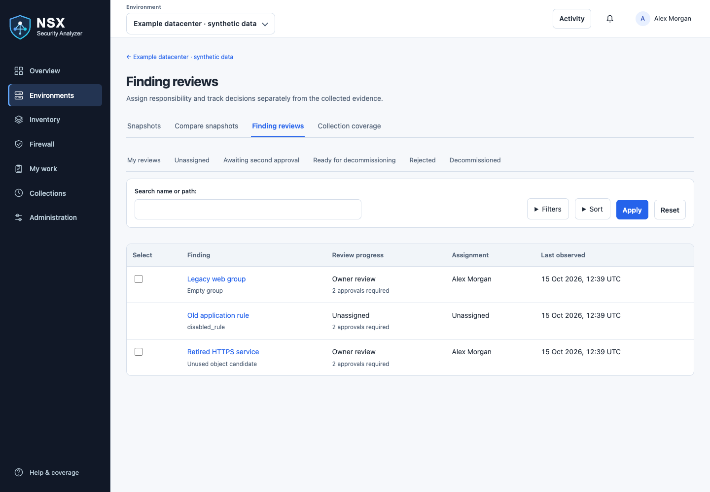
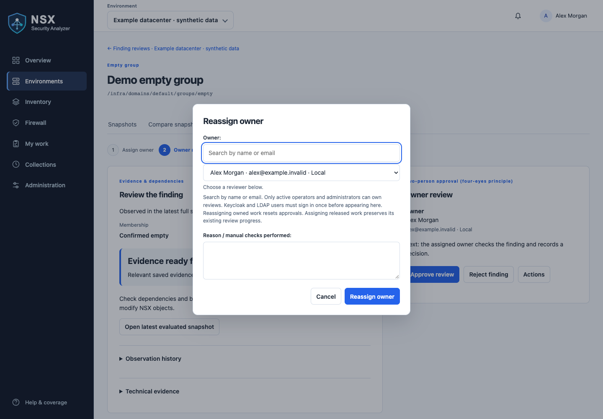
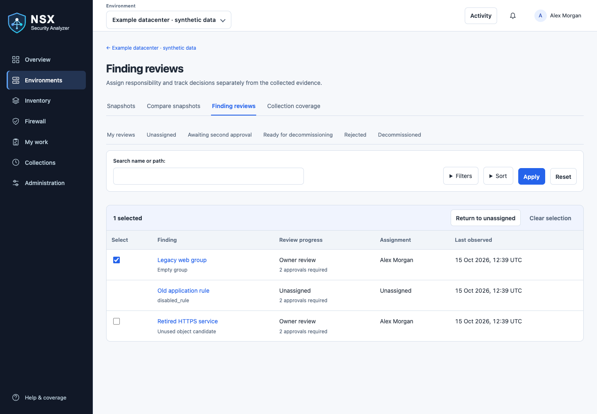
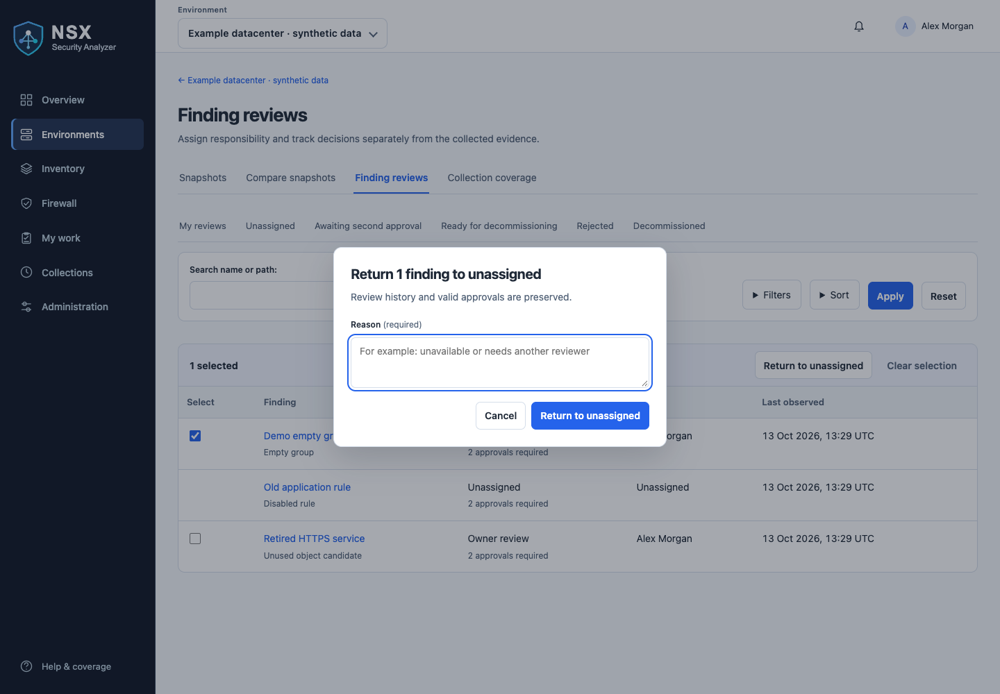
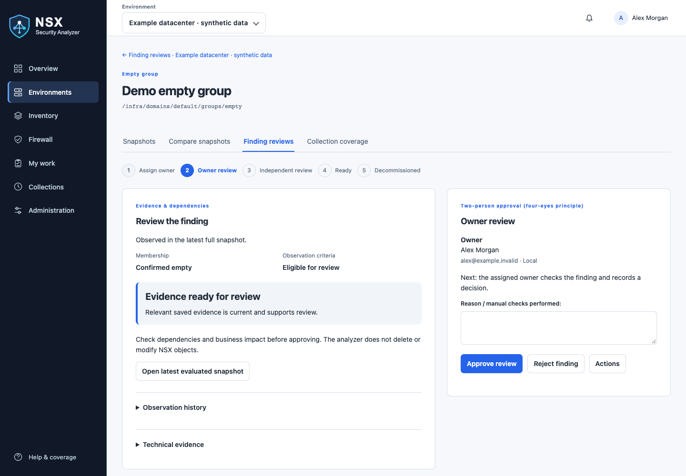
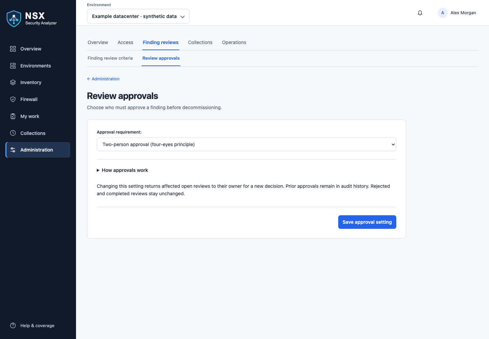

# Finding review workflow

This guide describes how findings are reviewed, approved and, optionally, deleted
from NSX. The in-app **Help & coverage → User guide** has the short version; this
page adds the detailed rules and safeguards.

## Overview

A finding is a review candidate produced from saved collection evidence, such as an
empty group or a rule with zero recorded hits. A review records a decommissioning
decision about that finding. **Approval alone never changes NSX.** You either make the
change through your own change process and record it, or an administrator uses the
separate [deletion workflow](#deletion-from-nsx), which has its own live checks and
explicit confirmation.

### Roles

| Role | What it can do |
| --- | --- |
| Viewer | Read Reviews, findings, evidence and history. No assignment, decision or selection controls. |
| Operator | Be assigned as owner, approve or reject, give an independent second approval, release own work, record completion. |
| Administrator | Everything an operator can do, plus release anyone's work, reopen completed reviews, change review settings and, with deletion permission, preview and execute NSX deletion. |

The same rules apply to local, Keycloak and LDAP accounts. Each person must use their
own account: the second approval is checked against stable account IDs, so changing a
display name or email cannot bypass the different-approver rule.

### Workflow stages

| Stage | Meaning |
| --- | --- |
| Unassigned | Eligible finding without an owner. Released work keeps its valid approvals here. |
| Owner review | The owner checks evidence and approves or rejects. |
| Awaiting second approval | Four-eyes only: a different operator or administrator reviews independently. |
| Ready for decommissioning | Required approvals are complete. Make the change, or use NSX deletion. |
| Decommissioned | Completion was recorded manually, or NSX deletion verified absence. |
| Rejected | The review ended with a reason. **Reopen review** starts a new owner review. |
| Suppressed | A transient-emptiness policy suppresses the empty-group finding. Not reviewable. |

### Finding types

| Finding | Approval category |
| --- | --- |
| Empty group, unused group, prolonged empty VDI group | Groups |
| Unused custom service | Custom services |
| Zero-hit rule, disabled rule | Firewall rules |
| Empty policy | Firewall policies |

Custom services have their own **Unused custom services (days)** criterion and their
own finding type (**Unused custom service** in the finding-type filter). Built-in or
system-owned services, referenced services and audit-excluded services never become
unused-service findings. Empty-group criteria and transient-emptiness policies do not
apply to services. If an expected finding is missing, check the object in the evaluated
snapshot and expand **Why some findings are not listed** in Reviews.

## Reviews queues

Open **Reviews** in the main menu for daily work. An environment's **Findings** link
opens the same workspace with that environment selected; older `/my-work/` and
environment findings bookmarks still work.



| Queue | Contents |
| --- | --- |
| **Assigned to me** | Your owner reviews and firewall cleanup plans you requested. |
| **Second approval** | Reviews and cleanup plans you can independently approve. Your own first approvals are excluded, even after the owner changes. |
| **Unassigned** | Currently eligible findings without an owner, including released work. |
| **Ready** | Owned, approved findings awaiting cleanup, plus cleanup plans you may execute. Preview and confirmation still recheck live safeguards. |
| **All findings** | Team oversight, including retained reviews. Use the **Stage** filter for rejected, decommissioned or suppressed records; these are not actionable queues. |

Findings and firewall reference cleanup plans share one database-paginated table:
Finding/task, Environment, Owner, Stage, Next action and Updated. Cleanup plans are
labelled by task type and show the requesting administrator as owner; **Task type**
limits the list to findings or cleanup. Cleanup discovery is bounded to 500 active
plans, with a notice and an environment filter when the bound is reached. The queue
does not load snapshot reports or compute full readiness per row; open an item for
authoritative readiness, evidence, decisions and history.

Queue badges count the whole selected environment scope before table filters; the
table footer shows matching tasks. Changing queues keeps environment, search, kind and
task type, clears incompatible owner/stage filters and resets the page. An empty queue
distinguishes "no eligible findings" from "no filter matches" and offers **Clear
filters** for the latter. Assigned findings stay visible when their evidence stops
qualifying, so the owner can see why a new collection or review is needed. Rejected and
completed decisions stay available after the condition disappears, and direct finding
URLs keep the full history.

### Keeping your place

The top environment control changes only list scope; Reviews, Overview, Activity and
Collections offer All environments or one environment. Switching keeps the review tab,
search and sorting, and resets pagination and selection. Individually opened findings,
deletion requests and cleanup plans show a fixed environment label. The environment
switch checks that the destination is available first; on failure or timeout the
current page stays visible with **Retry**.

Opening an item keeps the originating queue, environment, search, filters and page in
its back link. **Previous**/**Next** follow the filtered, sorted task list across
adjacent pages, including cleanup tasks. If a decision removes the item from those
results, return to the list to continue. Returning in the same browser tab restores the
list scroll position for up to one hour. Queue pages never write to NSX.

### Assign an owner

1. Open the finding and choose **Assign owner** (or **Actions → Assign owner** /
   **Reassign owner** when several actions are available).
2. Search by name or email in the **Owner** field and select a suggestion (arrow keys
   and Enter work). The selector searches users already provisioned in this
   application, not the whole identity-provider directory, and shows
   **Name · email · provider**. Selecting a reviewer replaces the result list with a
   summary; choose **Change** to search again. **Who can be assigned?** explains
   eligibility.
3. Confirm. Only active operators and administrators can be assigned.

Assigning an unassigned finding needs no reason; history records "Owner assigned."
Assigning released work resumes its saved stage with existing approvals. Reassigning
already-owned work requires a reason and resets approvals to a new owner review.

In **Unassigned**, select rows (the header checkbox selects up to 100 on the current
page) and choose **Actions → Assign owner** to assign several at once. Findings changed
or assigned by someone else since selection are skipped with an explanation.



*Reassign owner uses one searchable user selector. Reassigning owned work resets
approvals; assigning released work preserves valid progress.*

### Return to unassigned

Operators can release their own reviews; administrators can release anyone's. A reason
is required, and history records the actor, previous owner and reason.

- On a finding, use **Actions → Return to unassigned**. Without JavaScript, the detail
  page's action form still works.
- On Reviews, select eligible rows to reveal the selection bar, choose **Return to
  unassigned**, enter one shared reason and submit (up to 100 rows on the displayed
  page; requires JavaScript). Cancel, **×** or Escape closes the dialog and keeps the
  selection.

Released findings keep their review stage, approvals, comments and evidence. They show
"Awaiting assignment · owner approval preserved" or "Awaiting assignment · approvals
preserved" and leave the Second approval and Ready queues until an owner is assigned.
The next approval or completion requires an owner, and the original first approver
still cannot give the second approval. Evidence and policy changes invalidate approvals
as usual. The server rechecks each finding's revision and permission; changed or
ineligible rows are skipped with individual reasons.





### Bulk actions

Select rows to reveal **Actions**. Selection covers eligible rows on the current page
only (up to 100); other selection cells stay empty. Actions that cannot apply to the
whole selection are disabled with an explanation. Changes open a review screen and need
explicit confirmation; exports download JSON without changing NSX.

| Page | Available actions |
| --- | --- |
| Reviews | Assign unassigned findings (to yourself or another reviewer); reassign owned findings with a reason; return to unassigned; export evidence; administrators can preview deletion of ready findings from one environment. |
| Firewall reference cleanup tasks | Cancel pending plans or export plans and outcomes. The complete-plan page can record approvals together; each plan keeps its own distinct-approver requirement. |
| Deletion history | Export object outcomes, or download saved configurations and cleanup plans. Missing configurations are marked. |
| Inventory groups and services | Export saved objects, compare details side by side, or open related finding reviews. No deletion here. |
| Collections and collection history | Export diagnostics or cancel queued collections with a reason. Stop running collections individually. |

Selecting one task type (findings or cleanup) clears the other selection. Mixed views
allow assignment only when every selected row is unassigned. Results list succeeded,
skipped and failed items with reasons; the server rechecks type, role, revision and
state when applying.

### Notifications

The notification bell lists assignments for the owner and second approvals for other
eligible reviewers, including cleanup plans. Turn these off in **Personal settings →
Notifications → Finding assignments and second approvals**; this setting is independent
of collection notifications. Marking notifications read does not remove work from the
queues.

## Evidence and readiness

Every approval requires an eligible, currently observed finding from the latest full,
non-testing, non-imported snapshot within the freshness threshold (**Administration →
Freshness & notifications**). Approval checks use the object's saved, indexed evidence.

| Finding | Required evidence |
| --- | --- |
| Empty group | Membership successfully confirmed empty |
| Zero-hit rule | Fresh zero counters with successful zero-hit status; the rule is not disabled |
| Unused object | Unused candidate with unrestricted search, or successful compatibility search plus independent manual verification by each required reviewer |
| Disabled rule | Explicitly confirmed disabled state |
| Empty policy | Successful empty status and exactly zero rules |

Missing indexed evidence, exclusions, and unknown or contradictory values block approval
with a specific explanation. Unrecorded or failed search blocks unused-object approval.

### Manual verification and limited search coverage

When a collection had to use the compatibility search (a defined list of searchable
object types), unused groups and custom services show **Limited dependency-search
coverage — additional checks required** with the searched types. Each required
reviewer must confirm an independent dependency check, describe what was checked
outside the collected scope and give a ticket or evidence reference. The first
reviewer's confirmation never substitutes for the second's. This is separate from the
single/four-eyes setting, and approval does not relabel coverage as complete. Empty-group
findings use membership evidence instead.

Search is eventually consistent and limited by permissions, so even unrestricted search
does not prove that every dependency is visible.

### Inventory warnings pause affected findings

Inventory verification warnings pause the findings that depend on the affected
evidence. Dedicated VM inventory warnings pause empty-group and tag-dependent checks;
unrelated service and firewall findings continue only with complete required evidence.
Group membership warnings are scoped to their group. Firewall inventory inconsistencies
also block unused-object reference checks. Unknown endpoint scopes, unclassified
warnings and configuration inventory/search inconsistencies remain blocking.

During a pause, decisions are kept when criteria are unchanged, and the queue shows
**Verification paused — decisions retained** or **Approved — execution verification
required**. Paused observations are not counted and do not bridge observation
continuity. Verified relevant configuration changes and changed criteria still apply
and can invalidate approvals.

### When approvals stay valid

Each approval stores the actor, timestamp, reason, source snapshot, evidence
fingerprint, evidence, reference-search scope and any manual verification details.

- A routine collection with unchanged relevant evidence keeps pending approvals.
- Relevant evidence changes, a disappeared condition, incomplete relevant evidence or a
  recalculation that removes eligibility invalidate pending approvals; the owner must
  review again. Ownership and history remain.
- A changed reference-search scope requires a new owner review.
- Stale data blocks final approval and completion until a fresh full collection exists.

### Reading the review page



*Synthetic documentation data. Available actions depend on your role and review state.*

The progress indicator shows the stage. Evidence and dependencies are on the left; the
owner, next action and decision controls are on the right (below on small screens).
The readiness banner separately lists missing evidence or required manual verification:
meeting observation criteria does not by itself permit approval. Validation errors keep
entered notes.

- **Load saved technical evidence** opens the saved evidence on demand.
- **Verify current state** (operators and administrators) runs a read-only live check of
  configuration, membership and references. Its results are separate from saved
  observations; up to 2,000 entries per list are kept for browsing. Deletion repeats
  its own checks.
- **View object in saved snapshot** opens the exact object in the snapshot used for
  evaluation (which may be older than the newest collection) and highlights its row.
  **Back to finding review** returns with your queue context.
- **View saved impact preview** opens the [impact preview](#impact-preview) for that
  snapshot.

Action dialogs (assign, reassign, reopen, return to unassigned) have a fixed action
footer; close them with **Cancel**, **×** or Escape.

### Impact preview

Open **Impact preview** from a finding or from an object's snapshot details. The
read-only page shows exact collected references, nested group chains, rule
source/destination/Applied To usage, containing policies and rules removed with a
policy, linked to the same snapshot. Repeated nodes and cycles are shown once; depth
and relationship count are bounded and truncation is disclosed. Unknown referencing
objects stay visible as unresolved.

Configuration dependencies do not establish traffic impact: removing a rule can expose
later rules or default actions. "No references" means none were found within collected
coverage. Impact preview is optional, but if you opened it from a finding and the
evaluated snapshot then changes, approval from that browser session requires opening
it again.

VM and tag drawers offer their own previews. A VM preview shows explicit VM path
references and potential tag-condition relationships through parent groups, rules and
policies; these objects are not deleted with the VM. For a tag, select a specific VM
assignment to preview its removal; this is not a simulation of deleting a tag catalog
entry. Potential tag relationships do not prove membership: other criteria, AND/OR and
negative conditions can change the result. Chains are limited to 200 relationships and
eight levels.

### Audit history

Each assignment, decision, reset and completion writes a review-history event and an
application audit event in the same transaction. Conflicting edits are rejected; reload
to see the current decision. Failed workflow actions are also audited.

**Review history** on the finding lists actor, time, action and reason. **Export audit
history (JSON)** (operators and administrators) includes decisions with saved evidence
and stable actor IDs; historical identity values are preserved, and the page resolves
older internal Keycloak identifiers to names when the account still exists.

Review history survives snapshot retention and keeps actor names after user deletion.
An environment with deletion records cannot be deleted. Otherwise deleting an
environment deletes its finding history, while application audit events follow their
own retention. Export records first when longer retention is required.

## Approvals

### Approval modes by category



In **Administration → Review approvals**, administrators set a workspace default and
optional overrides for **Groups (including VDI)**, **Custom services**, **Firewall rules**
and **Firewall policies**. Each override is **Inherit default**, **Single approval** or
**Four-eyes**; four-eyes is the default. Settings apply across environments. Finding
details show the effective mode and its source.

- **Single approval:** the assigned owner's approval moves the finding to **Ready for
  decommissioning**. All evidence and manual-verification requirements still apply.
- **Four-eyes:** a different operator or administrator must also approve. The owner
  cannot give the second approval, even as an administrator.

**Preview changes** shows effective modes and how many open reviews would be affected,
without saving. Saving resets approvals only where an open review's effective
requirement changes; ownership and history remain and the reset is audited. Rejected
and completed reviews are unchanged.

### Two-person review

1. **Assign.** Assign an owner; the finding enters **Owner review**.
2. **Owner review.** The owner opens **Reviews → Assigned to me** (or the notification),
   inspects the evidence and the readiness banner, writes the checks in **Reason /
   manual checks performed**, completes manual verification where required, and
   chooses **Approve review** or **Reject finding**. Rejection does not need the
   approval confirmation.
3. **Second approval.** A different operator or administrator opens **Reviews → Second
   approval**, reads the owner approval, inspects the evidence independently, records
   their own reason and verification details, and approves or rejects.
4. **Ready.** The finding moves to **Ready for decommissioning**. Nothing is deleted
   automatically.
5. **Complete.** Make the change through your change process and
   [record it](#record-an-external-change), or use [deletion from NSX](#deletion-from-nsx).

With single approval, step 3 is skipped.

### Example: two-person review with Keycloak users

Both reviewers sign in once with **Sign in with Keycloak** so their accounts are
provisioned. Their Keycloak role mappings must grant **Operator** or **Administrator**;
viewers cannot be assigned or approve. If a name or email is missing in the selector,
correct the identity-provider profile or claims and sign in again.

1. Open **Reviews**, select the environment, open the finding and assign the first
   reviewer as owner.
2. The owner signs in, opens **Reviews → Assigned to me**, uses **View object in saved
   snapshot** and **Load saved technical evidence**, and approves with a reason.
3. The second reviewer signs in, opens **Reviews → Second approval**, reviews
   independently and approves.
4. Either reviewer opens **Reviews → Ready**, performs the change through the normal
   change process and records completion with the change ticket.
5. Check **Review history** on the finding, or export it as JSON.

### Record an external change

For a change made outside the analyzer, open the finding in **Reviews → Ready**. The
decision panel then shows **Change-ticket reference**. Enter the ticket and describe
what was done, then choose **Record decommissioning**. The finding becomes
**Decommissioned**.

This is a manual attestation, not proof of deletion. Record it before a new collection
removes the condition; otherwise the pending approval is invalidated and the finding
must be reviewed again. Manual completion attempts a read-only absence check before
closing [related findings](#related-findings).

### Rejection, reopening and reassignment

A rejection ends the review and keeps its reason. **Reopen review** starts a new owner
review and requires an explanation. An administrator can reopen a decommissioned
finding with a reason; this archives prior approvals and the change reference in
history and does not undo any NSX change. Reassigning owned work clears approvals.

### Who can confirm execution

**Administration → Review approvals → Who can confirm execution?** has a workspace
default and the same per-category overrides.

| Setting | Who can confirm deletion |
| --- | --- |
| **Requester only** (default) | The administrator who created the deletion preview |
| **Either approver** | A current, valid reviewer of the finding |
| **Requester or either approver** | The requester or a valid reviewer |

Every executor must be an active administrator with NSX deletion permission. A
single-approval review has one eligible approver. For reference cleanup, the approvers
of the exact cleanup plan count, not the original finding reviewers, and both the group
and firewall-rule policies must allow the executor; conflicting policies can leave no
eligible executor, and the page says so. Changing these settings does not reset
approvals, but eligibility is checked at confirmation and again before each change.
Requester and actual executor are recorded separately.

If a request contains objects needing different executors, confirmation creates a
linked execution request with only the objects you may execute; the others stay pending
in the original request. Repeated submission cannot queue the same items twice.

## Observation criteria and badges

Configure criteria in **Administration → Finding review criteria**. Environment
overrides take precedence over global defaults.

| Setting | Default |
| --- | --- |
| Zero-hit rules (days) | 90 |
| Empty groups, unused groups, unused custom services, empty policies, disabled rules (days) | 30 each |
| Minimum successful observations | 3 (minimum 2) |
| Maximum collection gap (hours) | 0 = automatic |

### Reading observation badges

A badge such as **zero hits: Eligible for review** says whether the finding meets the
configured evidence requirements. The line below shows **complete observed days /
required days · successful observations**.

| Example | Meaning |
| --- | --- |
| **zero hits: Eligible for review — 8 / 7 days · 192 observations** | The qualifying sequence spans 8 complete days and 192 successful checks; both requirements are met. |
| **zero hits: Observing — 0 / 7 days · 19 observations** | 19 qualifying checks, but less than 24 hours between the first and latest. The day count rounds down to 0. |

Observations are checks, not traffic hits. Both elapsed time and the minimum count must
be met, so many checks in one day cannot replace the period. Days are measured between
qualifying snapshots: time after the latest snapshot does not count, and waiting without
collections does not advance a finding.

| Required days | Requirement |
| --- | --- |
| 0 | One confirmed observation in the current collection |
| 2 | At least 48 hours between the first and latest qualifying snapshots, plus the minimum observations |
| 3 | At least 72 hours, plus the minimum observations |

Zero-hit rules also need fresh counters in each collection; missing or repeated
counters do not count.

**Eligible for review is not approval to delete.** Zero recorded counters do not prove
that no traffic occurred between checks. Open **Observation history** on the finding
for the period start, last observation and explanation. Historical badges reflect the
assessment saved with that snapshot.

### Maximum gap and restarts

With **Maximum collection gap** set to 0, the gap is twice the environment's collection
interval, with a minimum of 24 hours. A longer gap between qualifying snapshots restarts
the period. Relevant rule or object changes and changed criteria also restart it.
Missing, unknown or opposite evidence interrupts continuity. A low day count alone does
not say which of these happened; read the observation history.

### Recalculation

Saving criteria replays retained history without a new collection. While recalculation
is queued, running or failed, affected finding types cannot receive first or second
approval or record completion; unaffected types stay reviewable and rejection remains
available. If recalculation fails, an administrator saves the criteria again and waits
for success. The completion message reports recalculated and paused findings
separately. Outcomes appear under **Administration → Finding review criteria**, and
administrators can cancel a running recalculation; save the criteria again to request a
new one.

### Expected transient emptiness

Some session-driven groups, such as VDI pools, are legitimately empty between sessions.
Administrators manage policies in **Administration → Finding review criteria → Manage
transient-emptiness policies**. A policy has a name, an exact case-sensitive membership
tag scope (for example `VDI_Gebruiker`), a reason, and one environment or all
environments. Scope suggestions come from saved group definitions. **Preview** shows
matching groups and existing empty-group findings without contacting NSX.

Only pure positive VM Tag `EQUALS` conditions using that scope match. Mixed scopes,
nested groups, negative conditions and other member types are excluded. The policy
matches the scope in membership conditions, not tags attached to the group. When
policies overlap, the oldest enabled matching policy wins.

| Mode | Effect |
| --- | --- |
| **Always suppress** (default) | Matching empty-group findings become **Suppressed** (Reviews → All findings, Stage = Suppressed) with the policy and reason. They cannot receive cleanup approval; active approvals are invalidated. Inventory, membership evidence and unused-object findings are unchanged. |
| **Monitor prolonged emptiness** | Uses its own empty period (default 14 days), minimum observations (default 3) and maximum gap (default 24 hours). Qualifying groups appear as **Prolonged empty VDI group** in the Empty group category. Any confirmed membership resets the period and invalidates active cleanup approvals; missing evidence and excessive gaps interrupt it. |

Saving or disabling a policy replays retained history. Disabled policies return groups to
normal criteria; earlier approvals are not restored. Policy changes are audited. "Empty
in every qualifying observation" does not prove continuous emptiness between
collections. No extra NSX polling or changes to external VDI scripts are needed.

### Recover a first approval after a collection gap

If a collection gap invalidated an owner approval, an administrator can open the finding
in **Owner review** and choose **Preview approval recovery** in Review history. The
preview changes nothing and shows the original approver, time and reason, or why
recovery is blocked. Confirming restores the first approval and returns the finding to
**Awaiting second approval**; it is recorded as a separate administrator event. Second
approvals are never restored, and the original approver still cannot give the second
approval.

Recovery requires a completed recalculation, current eligible evidence, the same active
owner, unchanged evidence and coverage, stable object identity, retained evidence across
the interval, and a saved assessment that explicitly proves the interruption was a
collection gap. Later workflow actions, missing history or ambiguous invalidation
reasons block it. Increasing the maximum gap does not guarantee recovery. Checks run
again on confirmation; reopen a stale preview. When blocked, obtain a fresh owner
approval.

## Deletion from NSX

Administrators with deletion permission can delete approved objects through a
three-step flow: **preview → confirmation → execution**. Collection itself remains
read-only; only this workflow writes to NSX.

### Supported targets

| Supported | Blocked |
| --- | --- |
| Local-manager groups | VM and tag operations |
| Custom services, including their service entries | Global Manager and project objects |
| DFW rules | Protected, system-owned or default objects, and rules in system policies |
| Empty DFW policies | Referenced objects (except through a [reference cleanup plan](#reference-cleanup-plans)) and objects with unsupported child configuration |

Empty policies need a snapshot that contains their configuration and identity before they
can qualify. The saved NSX account needs write permission for the target; the analyzer
never elevates permissions. A successful read-only preview or credential test does not
prove write permission.

### Using the deletion preview

1. In **Reviews → Ready**, select ready findings and choose **Actions → Preview deletion
   from NSX**, or choose **Preview deletion from NSX** on a ready finding. A request can
   contain up to 100 findings from one environment; repeated paths are deduplicated.
2. Wait for the read-only preview. Active requests refresh every five seconds. The
   summary separates verified, blocked and already-absent objects; expand verification
   details or diagnostics where needed and check each saved-snapshot impact link.
3. Open **Review permanent deletion**, check names and paths, enter a change ticket and
   tick the permanent-deletion confirmation **within ten minutes of each object's
   verification**. Only verified rows are submitted.
4. The worker executes **within one hour of confirmation**. Refresh the request and check
   every row: a completed request can contain unsuccessful objects.

Closing the confirmation dialog cancels only that submission. Once execution is queued,
there is no rollback.

### What the preview checks

For each object the preview verifies valid approvals, fresh evidence, exact identity and
approved configuration (including relevant parent-policy settings for rules), the
finding's condition (membership or rule state), and live incoming references.

- **Live references** require a complete, unrestricted dependency search. Limited or
  failed coverage blocks deletion; the manual-verification approval route cannot
  override this.
- **One shared live dependency scan per run.** Objects in the same preview or execution
  run reuse one complete scan for up to 120 seconds after it finished. Failed, limited or
  warning-bearing scans are never shared, and the scan is discarded after a reference
  cleanup changes rules. Identity, condition and membership checks stay per object and
  fresh. The cache lives only inside one worker job.
- Previews check up to three objects concurrently on PostgreSQL. NSX changes are always
  sequential.
- A fresh membership response cannot replace historical VDI criteria, and fresh counters
  cannot replace the zero-hit observation period.

Each verified object records its verification time and per-check timings (identity and
approvals, dependency scan, remaining condition and reference checks, total) and whether
it reused the shared scan. Progress counts completed checks, not time remaining; a long
live search can leave the count unchanged. These durations exclude queue waiting.

### Confirmation and execution

The finding approval and the deletion confirmation are separate authorizations:
**finding approval → live preview → administrator confirmation → final checks → DELETE**.

- Each object must be confirmed within ten minutes of its verification. **Refresh
  verification · retain unchanged approvals** rechecks an unconfirmed request in the
  preview worker; only unchanged objects and cleanup plans keep their decisions.
  Rejected, cancelled, failed and partially executed requests cannot be refreshed.
- Confirmation authorizes execution for one hour, including queue wait and live checks.
- Execution repeats the live checks, rereads the object and parent policy immediately
  before the DELETE, and checks the authorization deadline again. Changed or expired
  items are blocked. Group deletion uses `fail_if_subtree_exists=true`.
- Each object gets one DELETE; there is no force option and no automatic retry. Durable
  intent is recorded before each DELETE. Only an accepted DELETE followed by a read that
  confirms absence marks the review **Decommissioned**.

Search and DELETE are separate operations: search is eventually consistent, permissions
can hide dependencies, and external changes between checks and DELETE cannot be
prevented atomically. Avoid concurrent NSX changes and review business impact
independently. API references:
[Group deletion](https://developer.broadcom.com/xapis/nsx-t-data-center-rest-api/latest/method_DeleteGroup.html),
[Rule deletion](https://developer.broadcom.com/xapis/nsx-t-data-center-rest-api/latest/method_DeleteSecurityRule.html).

### Dependency order in one request

If objects in the same request reference each other (for example a rule that uses a
group in the request, or a parent group that contains another), the preview records the
dependency instead of blocking, and execution deletes the referencing objects first.
Objects verified absent earlier in the run are not counted as references, even if the
search index still lists them. A cycle keeps the remaining order, and the live checks
block whatever is still referenced.

### Results

| Result | Meaning and next step |
| --- | --- |
| **Verified** | Preview checks passed; confirmation is still required. |
| **Deleted** | NSX accepted the DELETE and a subsequent read confirmed absence. |
| **Already absent** | The object was gone before this deletion; not proof the analyzer deleted it. |
| **Blocked** | A check did not allow deletion. Read the reason, resolve it and create a new preview. |
| **Failed** | NSX rejected the request (for example permissions). Review the reported error. |
| **Uncertain** | The outcome could not be confirmed, or the worker stopped after sending. Check NSX before trying again. |
| **Not attempted** | The object could not finish before the worker limit or the one-hour authorization, or the worker stopped first. No change was made. In a preview this appears as **Not checked**. |

There is no automatic rollback; partial success is possible.

**Preview remaining work** on a finished request opens a selection of its unfinished
findings. Deleted, already-absent and delegated items are excluded, and findings no
longer ready are reported instead of selected. Submitting creates a linked, read-only
preview with fresh checks and a newly built cleanup plan; it does not retry the original
writes or carry over execution approval. An active request must finish first.
**Create new preview** returns to the Ready queue for a deliberate new selection.

### Related findings

When deletion verifies absence, every open finding with the same environment, path,
unique identity and creation time is also marked decommissioned. For example, deleting
an approved empty group also closes its unused-group finding, even if that review was
unassigned. This records the outcome; it does not approve the related finding, and its
history links to the primary finding and deletion request. Failed or uncertain deletion
never closes related findings. A different object later collected at the same path
starts a new review without inheriting approvals.

### Reference cleanup plans

A referenced empty group can enter **Reference cleanup required** instead of being
blocked, when its live dependencies are only ordinary local DFW rule source/destination
lists.

- If another group remains in the list, the plan proposes removing the empty group from
  it.
- If the empty group is the sole source or destination, the plan explicitly proposes
  deleting that rule before the group. The parent policy is kept.

Applied To, negated groups, IP literals or ANY in the changed list, protected or global
objects, child configuration, rules with incoming references and non-DFW dependencies
stay blocked with guidance. No ANY replacement, implicit rule deletion or rule disabling
is offered.

**Approval.** Choose **Review reference cleanup** to see policy and rule names, enabled
state and current/proposed values (changed lists are summarized; **Compare
configuration** shows exact paths). The plan needs separate administrator approval
using the strictest of the finding's requirement and the current group and
firewall-rule settings; four-eyes needs two distinct, currently authorized
administrators. Second reviewers find the task in **Reviews → Second approval** and
notifications. The first approver sees **Your approval is recorded**; another eligible
administrator sees **Submit second approval**. Rejection needs a reason. Finding
approvals never approve firewall edits.

**Confirmation.** Cleanup approvals do not expire. When approvals complete while the
preview is still within its ten-minute window, it stays ready to confirm; otherwise a
read-only revalidation is queued. The executor gets a **Ready to confirm** notification
and has ten minutes to confirm the rule changes and deletion with a change ticket.
**Revalidate approved plan** renews an expired confirmation window; it never executes.

**Execution.** Execution repeats object, membership, dependency and approval checks.
Each rule update uses the approved `_revision` with redirects, force and automatic
retries disabled, following the
[DFW rule update API](https://developer.broadcom.com/xapis/nsx-t-data-center-rest-api/latest/method_UpdateSecurityRule.html),
and is read back and compared with the plan. Only `_revision`, `_last_modified_time` and
`_last_modified_user` are ignored as server metadata; any other change to the rule or
parent policy stops execution and names the changed fields. A planned rule deletion
repeats live checks and an exact identity read before one DELETE, must verify absence
before continuing, closes identity-matching rule findings and keeps the rule's original
configuration. Full dependency and membership checks run again before the group DELETE.

Rule updates and deletions are **not atomic**. Completed changes remain when a later
step fails, and the page shows **Partially completed** with per-rule outcomes; nothing is
rolled back or retried. **View rule cleanup and outcomes** keeps the original and
proposed JSON for manual reconstruction. If two selected groups share a rule, the first
change can invalidate the second plan; create a fresh preview for the remaining group.

**States.** Awaiting cleanup approval / Awaiting second approval, Revalidating, Ready to
confirm, Executing, and Completed / Needs attention. The page shows approval progress
while waiting and operation progress only after confirmation. Rejected and cancelled
plans leave the active queues; their history remains. A new preview reuses an active
request that already contains the object instead of creating a concurrent plan.

**Cancellation.** **More → Cancel cleanup plan** withdraws one object's plan (optional
reason). Other objects in the request are unaffected, and the finding stays ready; a
later attempt needs a fresh preview and fresh cleanup approvals.

### Complete-plan review and optional execution authorization

**Review complete plan & execution options** shows the selected deletions and exact
firewall edits together. An administrator can record their cleanup approval for all
pending plans at once; each plan still needs its configured number of distinct
approvers.

The optional **Execute after final approval** form takes a change ticket and an explicit
authorization of the exact permanent changes, valid for one hour. The requester or a
recorded approver can authorize it, if the execution policy will allow them to execute
every object. When the last approval arrives, stale preview checks refresh first, then
the normal worker runs full execution checks. Changed plans, lost permissions or failed
checks stop it. The authorization can be revoked while waiting; once queued, use
cancellation on the deletion request.

### Saved deletion configuration

**View deleted configuration** on a deletion result, or in the finding's **Saved deletion
configurations** section (administrators), shows the original ID and path, Manager,
environment, requester, timestamps, change ticket and outcome. Groups also show their
description, tags and membership expressions. **Copy JSON** and **Download JSON** give
the saved raw object; without JavaScript the link opens a standalone page.

The data is labelled **Saved before deletion** and comes from the read-only preview, not a
live query. It stays available through the deletion request after the snapshot or
finding is removed; snapshot retention does not remove deletion records. If nothing was
captured, the page says so.

This is for manual recreation only: there is no restore API or rollback. The raw JSON
contains server-generated fields and must not be submitted blindly. Recheck current
state first. Recreating an object does not restore separately deleted references,
rules, runtime state or counters, and dynamic membership follows current inventory.
Type-specific guidance appears beside the JSON.

### Cancellation

Deletion request pages can cancel queued or running read-only previews and confirmed
deletions still waiting for a worker. Cancellation and worker claim use the same
database lock. Once execution starts, cancellation is unavailable; inspect the
individual outcomes. A cancelled preview cannot publish late results or be confirmed.
No cancellation sends a DELETE or rolls anything back.

Comparison and recalculation pages also offer cancellation to administrators. Running
work shows **Cancellation requested** until the worker stops at a safe checkpoint.
**Pause updates** only pauses screen refresh; it never affects background work.

### Deletion history and Activity

The **Deletion history** tab beside **Decommissioned** lists requests, requester, change
ticket, object counts and outcomes, 25 per page, with up to three object names per
request (**View all objects** shows the rest). Search by object name, path or change
ticket and filter by outcome and type; matching requests still show their full object
list. Object records stay visible after a finding is removed. History and deletion
details require deletion permission.

**Activity → All activity** combines background jobs, review decisions and deletion
requests. **Running tasks** shows queued and running collections, indexing, comparisons
and, for deletion administrators, previews and execution. **Audit history** pages
through review and deletion audit records, including confirmations and per-object
outcomes. Filter by environment, type, actor, inclusive date range, object or ticket,
and outcome or review state. Events without an actor show System/background worker.
A finished request is not proof of deletion: inspect each object.

Automatic refresh keeps expanded sections, focus and scroll position. Opening a dialog or
editing a field in a refreshed region pauses updates with a message; network failures
show a refresh message and never resubmit. Evidence links read **View finding**, **View
saved configuration** and **View saved impact preview**; missing targets are explained
instead of linked.

## Troubleshooting

### Blocked previews

A ready stage and an eligible saved object do not override current inventory
verification. If the latest full collection has inventory warnings, the preview shows
its timestamp, warning details and links to coverage and diagnostics. Resolve the
warning, complete a verified collection and evaluation, then create a new preview. Old
blocked previews remain historical results.

**Targeted verification when global VM pagination is incomplete.** For a local group
whose definition is one or more positive VM Name or Tag `EQUALS` conditions joined only
by AND, a deletion preview can rely on retained qualified history plus direct live
membership checks. Every intervening full snapshot must have only the recognized global
VM inventory warning and the same group configuration with empty membership evidence,
within the observation gap and unchanged criteria. The live preview and execution then
require explicit zero counts, empty results and no cursor from the VM, IP address and
logical-port membership endpoints. OR, nested, mixed and extended definitions stay
blocked. Normal finding approvals remain paused; no historical observations are created.

When this path is unavailable, the preview gives a reason code: unsupported definition,
missing or incomplete approved history, intervening collection warnings (with collection
ID and time), missing or changed group evidence, changed criteria, or expired history.

### Live dependency-search diagnostics

Each preview result, including blocked ones, has an expandable **Live dependency-search
diagnostics** section with copyable JSON: attempted and successful queries, rejected
alternatives, search mode, HTTP status or error, coverage retries and runtime filtering
counts. These are live diagnostics, separate from the saved collection report.

The live search tries, in order: flat `NOT` exclusions, flat `!` exclusions (both
excluding VirtualMachine, VirtualNetworkInterface and GenericPolicyRealizedResource),
then `resource_type:*` and `*` with those runtime types removed locally after pagination
is verified. The explicit-type compatibility query is a last resort with limited
coverage and can never authorize deletion. All alternatives and retries share a budget
of five scans. Authentication failures, incomplete pagination and exhausted verification
block. The syntax follows the
[NSX search API](https://developer.broadcom.com/xapis/nsx-t-data-center-rest-api/latest/method_QuerySearch.html).

Duplicate runtime records are tracked for identity and completeness, but their payload
changes do not invalidate a configuration scan. Configuration conflicts, count
mismatches, missing objects and cursor failures remain blocking. On pagination failures,
`pagination_attempts` lists per attempt the reported total, unique count, raw rows,
pages, duplicates and per-type counts; attempts are never merged.

### Access failures

HTTP 401 (authentication rejected) and 403 (permission denied) show the method, object
path and guidance in deletion and cleanup results and in collection diagnostics, and are
recorded in worker logs and Activity. Diagnostics keep up to 100 distinct denied
endpoints per client with repeat counts, without credentials or response bodies.

If a firewall change or deletion is denied, execution for that group stops and the group
is not deleted. Earlier successful changes stay recorded and remaining rules show **Not
attempted**. Fix the service account permissions, review the outcomes and create a
fresh preview.

### Cleanup approval errors

An invalid earlier decision (changed plan fingerprint or a reviewer who is no longer
eligible) is an approval error, not a missing reviewer. The page shows the reason at the
top and pauses automatic refresh. The rejected submission adds no decision; correct the
cause or create a new preview and collect fresh approvals.

### Measuring deletion performance

Run this read-only command in a web container:

```sh
python manage.py deletion_performance --days 7 --json
```

It reports preview and execution sample counts and p50/p95 durations without object
names or configurations, using the latest attempt per item (at most 10,000 items).
Queue time is excluded. Compare equivalent batch sizes and environments; savings must be
measured, not inferred from tests.

## Upgrade notes

Run database migrations through the normal deployment step before starting the matching
web and worker version. Publishing an image does not update a running deployment.

- **Review workflow introduction:** existing Open/Acknowledged records became Unassigned
  or Owner review by owner; old acknowledgements never count as approvals.
- **Criteria recalculation:** after upgrading from a version that kept stale criteria,
  save the finding criteria again to queue a fresh recalculation.
- **Custom service criterion:** existing service reviews keep ownership, history and
  approvals; the service waiting period initially copied the previous shared setting.
- **`0047_deletion_verification`:** previews without per-object verification timestamps
  must be recreated.
- **`0048_reference_cleanup`:** adds reference cleanup plans; the migration makes no NSX
  changes.
- **`0060_deletion_execution_intent`:** adds the stored intent used by optional
  execution authorization.
