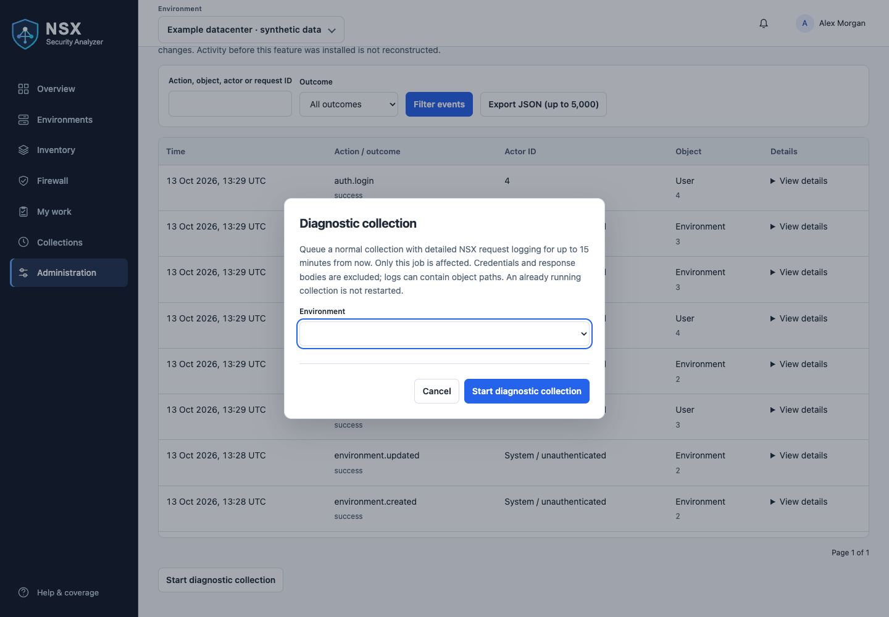

# Operations

See [snapshot maintenance and stopping collections](snapshot-maintenance.md) for optional refresh jobs and collection cancellation.

For CPU, memory and capacity planning, see [small, medium and large resource sizing](resource-sizing.md).

Run Compose commands from the folder containing your deployment's `compose.yaml`
and `.env`: the downloaded installation folder for Docker Hub, or `webapp/` for
a source build. Keep any override `-f` arguments on every command. Kubernetes
commands and ordered upgrades are in the [Kubernetes guide](../deploy/kubernetes/README.md).

## Initial administrator

Database migration `0017_initial_administrator` provisions `admin` with password
`NSXSecurityA!` when no superuser or account named admin (case insensitive) exists.
Change the initial password in Administration → Users & access after signing in.
The password is stored as a hash, never in audit events or startup logs.

This runs once per database, using migration history. Restarts and upgrades do
not reset passwords; deleting the initial administrator does not recreate it.
Existing accounts, including disabled administrators, remain unchanged. Restoring
a database also restores its accounts and migration history. Keep one migration
job per deployment and wait for it before starting application pods. This works
with bundled and external PostgreSQL; it does not provision a PostgreSQL login.

No manual account-creation command is needed with release **0.5.2**.

## Editing settings

Environment, review-policy, retention, authentication and personal-settings forms
show whether you have unsaved changes. With JavaScript enabled, leaving a changed
form prompts the browser to confirm navigation. This is a warning, not autosave:
save explicitly before leaving. Values remain in page memory and are not stored
by this feature in browser storage. Finding review drafts receive the same protection.

After server validation fails, an error summary links to the affected fields and
opens their collapsed sections. Authentication settings are grouped by connection,
user lookup (LDAPS), role mapping and certificate trust. Desktop save controls stay
visible while scrolling; on narrow screens they remain in the normal page flow.
Connection tests and certificate previews do not count as saving changes.

## Routine checks

```sh
docker compose ps
docker compose logs --tail=100 web worker scheduler
docker compose exec web python manage.py check
```

`/health/` is used by the container health check. Collection failures appear in the
workspace with expandable details. Check DNS/VPN connectivity, HTTPS reachability,
certificate trust and account permissions from the worker's network context.
A healthy web container does not establish that every NSX Manager is reachable.

## Upgrade a source build

For prebuilt images, use the [Docker Hub upgrade steps](docker-hub.md#upgrade-an-existing-compose-installation).

Back up the database and application secret first. Review changes and migrations.
For a maintenance-window upgrade, stop application processes before migration:

```sh
docker compose stop web worker scheduler
git pull --ff-only
docker compose build
docker compose run --rm migrate
docker compose up -d
```

Wait for active collections to finish before stopping workers where practical.
Review service health and collection history afterward. Do not roll back code across
schema changes without reviewing migration compatibility; restore a matching backup
if necessary. Avoid `docker compose down -v` unless deliberately deleting all data.

## Kubernetes and Argo CD upgrades

Use the [Argo CD upgrade procedure](../deploy/kubernetes/README.md#argo-cd-deployment-and-upgrades)
for GitOps deployments, or the [manual kubectl procedure](../deploy/kubernetes/README.md#manual-kubectl-upgrades)
when applying manifests yourself.

An immutable-field error on `migrate` means an existing Job is being updated in
place. The migration manifest uses a `Sync` hook with `BeforeHookCreation` so Argo
CD recreates that Job. Configuration/database resources run in wave `-2`, migration
in wave `-1`, and application Deployments in the default wave `0`. Full syncs run
hooks; selective resource syncs do not. Existing application pods are not stopped
by this ordering, so incompatible schema changes still need a maintenance window.

Retain migration logs before the next sync replaces the Job. If an old ordinary
Job blocks adoption, use the recovery instructions in the Argo CD guide. Do not
delete the PostgreSQL PVC or database to resolve a Job immutability error.

## Backups

For bundled PostgreSQL with default database/user names:

```sh
docker compose exec -T db pg_dump -U nsx -d nsx -Fc > nsx-workspace.dump
chmod 600 nsx-workspace.dump
```

Use your configured names when different. For a customer-managed database, use its
approved backup procedure. Preserve the deployment's `.env` securely and separately:
`DJANGO_SECRET_KEY` is required to decrypt saved manager credentials. A database dump
alone does not contain this secret.

Test recovery into an isolated database. Stop web, worker and scheduler before a
planned restore, restore with `pg_restore`, run migrations for the matching revision,
and verify configuration before restarting scheduling. If the application secret is
lost, saved manager passwords must be entered again.

## Retention

Retention is configured in Administration and is enabled by default. Review the
policy and its preview to see which records are eligible for cleanup. Pruning old observations affects the
available history window; deleted evidence cannot be reconstructed by later audits.
Retention is not a replacement for backups.

## Inventory changes during collection

Paginated inventory is checked for unique identities, conflicting object versions
and the reported total. A verification mismatch restarts that endpoint from page
one after 2 and then 4 seconds. Attempts are not merged. After three unsuccessful
attempts, the final deduplicated inventory may be saved with coverage warnings;
it is available to browse, but finding evaluation and approval are paused for the
environment. Existing finding presence and observation progress are not advanced.
Historical recalculation skips these unverified snapshots. A later verified full
collection is required to resume normal evaluation; rebuilding an index does not
verify missing NSX evidence.

For example, `1237/1238 unique objects; 1 duplicate rows` on
`/infra/realized-state/virtual-machines` means the response contains 1,237 distinct
VM identities against a reported total of 1,238. A duplicate does not fill the gap.
The message does not establish whether the cause is inventory churn, page overlap
or an inconsistent NSX count. VM runtime-only differences are tolerated for seven
known fields, but missing identities, tag changes and count checks remain strict.
See [verification details](collection-performance.md#diagnostics).

This differs from the cross-check that every directly collected group/service path
appears in configuration search. Persistent missing search paths after three
coverage attempts fail the collection; no new snapshot is published. Empty broad
search results with nonempty direct inventory trigger alternative query syntax,
including a limited explicit-type fallback. Limited scope remains visible.

Run another collection after changes settle. If the warning repeats, open
Collections → Diagnostics and capture the endpoint, reported/unique/duplicate
counts, attempt count, NSX version, job ID and actual worker build. Inspect the
worker logs and NSX API visibility/search health; do not treat a small discrepancy
as verified coverage. No counters or configuration are modified.

## Logging, audit trail and collection diagnostics

These features are included in release **0.5.2**. Pull and recreate application
containers when upgrading; restarting an older image does not update its code.

Application and Gunicorn logs use JSON on stdout/stderr with UTC timestamps,
severity, process/pod identity and application build. Web requests include a
server-generated request ID (also returned as `X-Request-ID`); collector logs
include job and environment IDs. Request routes omit query strings and raw URLs.
Successful health/poll requests are suppressed in application logs, while failures
are retained. Gunicorn logs method/status/duration without request payloads.

```sh
kubectl logs -n <namespace> <worker-pod> --since=1h --timestamps -f
kubectl logs -n <namespace> <worker-pod> --previous --timestamps
# From the local deployment directory:
docker compose logs --since=1h -f worker scheduler web
```

Set `NSX_LOG_FORMAT=text` for a readable single-line format; default is `json`.
Forward container output to your platform's centralized logging service with
restricted access, appropriate retention and alerts on ERROR events. Application
changes cannot recover logs from evicted pods or guarantee delivery when the
container runtime/logging service fails. No log files or sidecars are required
inside this application image. Configure your platform's log collection separately.

### Troubleshoot a collection



*Synthetic administrator view: Audit & diagnostics → Start diagnostic collection.
Selecting an environment and submitting starts a real diagnostic collection in your installation; the screenshot is illustrative only.*


Staff can open **Diagnostics** in collection history. The page shows the job ID,
saved stage durations, diagnostic expiry and sanitized exception chain. Live stage
starts, ends and 30-second heartbeats appear in terminal logs. Heartbeats indicate
a live process, not confirmed database progress. Nested stage messages are normal.

Database stages distinguish job-lock acquisition, snapshot write, finding
synchronization, completion update and transaction commit. Finding counters report
progress every 500 candidates. Only `collection committed` confirms successful
commit. A saved timeline is supplemental and is written after completion or a
handled failure; a killed process or database outage may leave none. Terminal logs
are the primary diagnostic source in that case.

Errors have stable codes and sanitized chained exceptions with file/function/line
locations, without local variables or source lines. PostgreSQL failures include
SQLSTATE where available but suppress driver messages that could contain SQL or
report contents. Timeout/exit/stale-job events do not claim an underlying cause;
correlate exit signals with Kubernetes termination reasons before concluding OOM.

Superusers can select **Start diagnostic collection** in **Administration → Audit &
diagnostics**, choose the environment in the dialog and submit it. It enables NSX DEBUG requests only for that job, for up to 15 minutes
from submission. It does not restart a running collection or enable Django DEBUG.
Warnings and errors remain enabled after expiry. Detailed logs can contain Policy
object paths; restrict access. Credentials, authorization values, connection secrets,
request bodies and snapshots are not intentionally logged. Redaction is defense in
depth; avoid putting sensitive free text in names or paths.

### Durable audit events

**Administration → Audit & diagnostics** provides superuser-only search, outcome
filters, pagination and JSON export (maximum 5,000 newest matching events).
Recorded actions include logins/logout/failed logins, access denials, environment
changes/deletion, credential or trust changes (boolean only), user/group/permission
changes, manual and scheduled job creation, review changes, collection outcomes and
retention cleanup. Actor/object identities are scalar IDs so records survive deletion.
Historical activity is not reconstructed. Direct SQL and bulk ORM writes outside
instrumented application paths are not covered; use database auditing if required.

HTTP `processed` events mean a mutation request was handled, not that its requested
change succeeded. Domain change records reflect committed transactions. Failed
requests/authentication are recorded separately; an unavailable database falls back
to console audit diagnostics and cannot provide a durable database record until a
logging backend captures it. Audit logs have no edit/delete UI, but a database
administrator can still modify them: use independent protected storage for stronger
tamper resistance. No tamper-proof or exactly-once delivery guarantee is made.

Audit events default to indefinite retention independently of snapshot cleanup.
Set `NSX_AUDIT_LOG_RETENTION_DAYS` to a positive number to remove older events in
batches of 1,000 through the scheduler. Cleanup itself is audited. Backups follow
your database backup policy; external log retention is configured separately.

## Default snapshot and collection retention

New installations enable automatic cleanup with these starting settings:

| Data | Retention |
|---|---|
| Full snapshots and their derived report indexes | 180 days |
| Testing snapshots | 7 days |
| Finished collection history (successful, failed or stopped) | 180 days |

180 days preserves the 90-day analysis window with additional comparison history.
Testing data has a shorter lifetime because it is not a full audit. These are starting
values, not a guarantee of database capacity: collection frequency, snapshot size and
environment count still determine storage requirements.

The scheduler performs cleanup at most once per hour. Keep the scheduler running.
The latest full snapshot and latest testing snapshot in each environment are always
preserved, even after their retention period. Retained snapshots protect their source
collection records. Environments with queued or running collections are skipped.
Deletion occurs in batches, so a backlog can take multiple cleanup cycles.

Migration `0028` enables existing disabled policies once on upgrade. Existing retention
periods, including “Keep forever”, are preserved. New policies use **180 / 7 / 180
days**. You can adjust the periods or disable cleanup afterward in **Administration
→ Retention**; normal restarts do not override that choice. Review the preview before
upgrading if you have historical data to retain. Expired data becomes eligible for
permanent deletion on the next scheduler cleanup; the migration itself deletes no data.

Audit-event retention is separate and remains controlled by
`NSX_AUDIT_LOG_RETENTION_DAYS` (default `0`, indefinite). Finding review evidence and
notes survive snapshot retention. Use database backups for longer-term recovery.

### Stopping a collection during database trouble

The Stop action persists a request in PostgreSQL; the supervising worker checks it
between subprocess waits and kills the collector before acknowledging cancellation.
Cancellation queries use a 5-second statement timeout and a 2-second lock timeout.
If database supervision raises an error, the worker kills the collector and logs
`database supervision failed`. The saved job status may remain Running until the
database recovers and stale-job reconciliation runs.

A full or unreachable database can prevent the stop request from being saved. The
UI reports that failure rather than claiming cancellation succeeded. SQL timeouts
bound server-side execution/lock waits, not every possible network outage. If the
worker cannot reach PostgreSQL, stop the affected worker through your container
platform and restore database availability. Coordinate replica changes with Argo CD
so it does not immediately restart the workload. Earlier committed snapshots remain
available; unfinished transactional work is rolled back.

Intentional built-in/system-object exclusions alone do not mark a full collection
incomplete. Unknown membership, missing rule evidence and collection errors still
need review. Check the collection coverage details before interpreting an incomplete
badge as an expected exclusion.

Extended identity expressions alone are a supported-scope limitation: when all normal
membership probes succeed without finding members, the group is labeled **Not supported**,
not empty or a collection failure. Other unknown evidence and request failures still
require review. This classification applies to newly collected snapshots; existing
snapshots preserve their original assessment. See the
[NSX Group schema](https://developer.broadcom.com/xapis/nsx-t-data-center-rest-api/latest/schemas_Group.html).

Antrea/container membership (including Namespace/Pod criteria) uses the same
scope-limitation classification. Successful probes with no
members result in **Not supported**, not an empty-group finding. API failures or
incomplete pagination remain **Unknown** and require review, even for these groups.
Positive resolved membership evidence remains **Has members**.

Nested group paths are inspected against the group inventory retrieved in the same
collection, without additional child membership API requests. If all referenced
group definitions use supported member types and the parent's membership probes
succeed with no members, the result is **Empty**. The collector does not union child
results or infer parent membership from child literals, preserving parent criteria.
Missing references, cycles and traversal depth limits remain **Unknown**. Nested
unsupported member types remain **Not supported**. Non-group paths not available in
the group inventory remain unknown rather than being assumed empty.


## Development builds and worker queues

Development builds before release 0.5.3 displayed version 0.5.2 with a newer commit build.
Release 0.5.3 incorporates those changes; always check both version and build.
Use `vkernel/nsx-security-analyzer:development-<commit>` for a pinned development
build, or the mutable `development` tag for testing. Pin the same published build
for migration, web, worker and scheduler; changing only the web image does not
update background processing. Release installation defaults are pinned to 0.5.3.

The default `audit_worker --lane all` supervises three independent queues, allowing
one collection, one finding-review indexing/recalculation and one comparison to run
side by side. Extra tasks of each type wait. PostgreSQL leases enforce these limits
across replicas; same-environment publication can briefly wait on a database lock.
See System health for each lane's heartbeat and worker logs for actual progress.

An older three-lane development build reused the comparison lease ID for finding
task claiming. The correction is included from build `0764747`. Stop old worker
replicas before starting corrected workers so their PostgreSQL session locks are
released. A correct image tag in YAML alone does not prove the running worker has
that image; inspect its pod image/imageID. In Kubernetes, update the manifests
actually used by the deployment or Argo CD, not just the converter compose.yaml.
For mutable tags, ensure new pods pull the intended image; a pinned commit tag
makes the rollout easier to verify. Coordinate worker restarts between active jobs.

The compact controls introduced in build `c90842f` need no snapshot refresh and
add no NSX calls. They include finding Actions dialogs, contextual bulk release,
a compact comparison toolbar, two-snapshot selection, a diagnostic collection
dialog and collapsible approval explanations. JavaScript is required for selection
shortcuts; direct finding forms and comparison selectors remain available.

### Repeated VM pagination warnings

VM inventory requests now explicitly request ascending `external_id` order on
`/infra/realized-state/virtual-machines` to reduce page overlap caused by unstable
ordering. The endpoint documents sorting parameters in the
[Broadcom API guide](https://developer.broadcom.com/xapis/nsx-t-data-center-rest-api/latest/method_ListAllVirtualMachines.html).
If NSX rejects the automatic sort with HTTP 400 on the first page, collection
retries that page without sorting and logs the fallback. Errors on subsequent
pages are not treated as sort rejection.

Sorting does not provide an atomic inventory snapshot. Unique-count checks,
conflict detection and three independent attempts remain required. A persistent
mismatch still pauses evaluation and approval; duplicates are never counted as
missing distinct VMs. If failures continue, retain the worker's three inventory
verification entries and the sort-rejection warning, if present, for diagnosis.

Action dialogs, including diagnostic collection and table column filters, use a consistent compact header, close button and fixed action footer. On short screens only the content area scrolls, keeping Cancel and the primary action accessible.

### Activity and automatic task updates

Open **Activity** in the top bar to follow collections, finding review indexing and snapshot comparisons together. Filter by environment, task type or active/failed status. Each type has its own worker queue. The view is bounded to 30 active and 30 recent tasks per type (60 when filtering by status); finding indexing shows the latest task per environment. Comparison age is time since its original request, not measured processing duration.

Activity, comparison preparation and finding recalculation status refresh while their page is visible, using your refresh interval. Updates pause inside a focused task region or an expanded detail to avoid interrupting reading. Collection state changes update in place instead of reloading the page, preserving snapshot selections. Follow **View collection result** when finished. Refresh the finding list after recalculation to load its new membership.

## Upgrading approval settings and confirmed deletion

Back up PostgreSQL and retain the existing encryption secret. Apply migrations
`0045_category_approval_modes` and `0046_approved_nsx_deletion` before starting the
matching web, worker and scheduler images. For development deployments, pin the same
`development-<commit>` image on all components, including the migration Job.
Category overrides initially inherit the workspace default; inspect **Administration →
Review approvals → Preview changes** before changing effective approval requirements.

Deletion previews and execution use the existing collection lane. A busy collection
can delay them; no additional worker is required. Refresh the deletion request page
for progress. Do not restart a worker during a confirmed deletion unless necessary;
interrupted or uncertain outcomes require checking NSX before a new request.

Collection uses read-only requests. Optional deletion uses the saved environment
credentials with their existing NSX permissions; a read-only NSX account cannot
perform it. Only application administrators can request and confirm deletion.
Deleting a finding or a snapshot is not a request to delete the NSX object.
Deletion records retain configuration and approval evidence beyond snapshot retention,
and protect their environment from deletion. Include them in database backup/access
controls. See the [deletion walkthrough](finding-review-workflow.md#using-the-deletion-preview)
for supported objects, safeguards and per-object outcomes.
