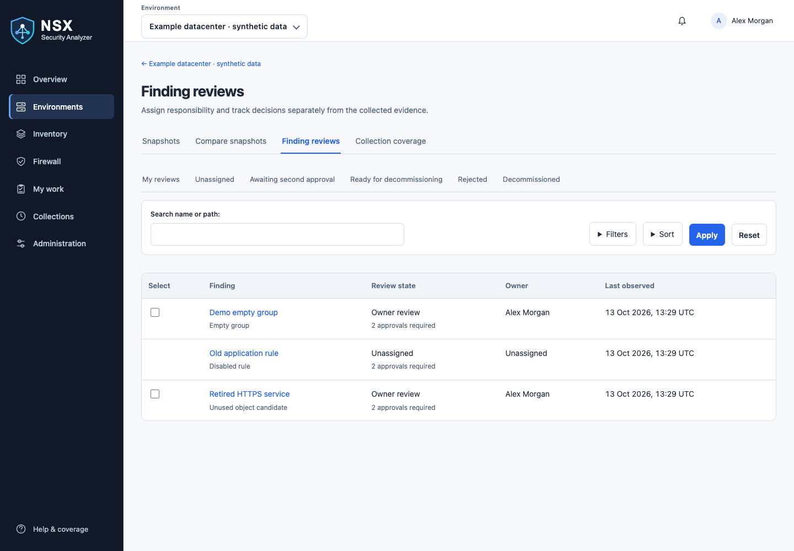
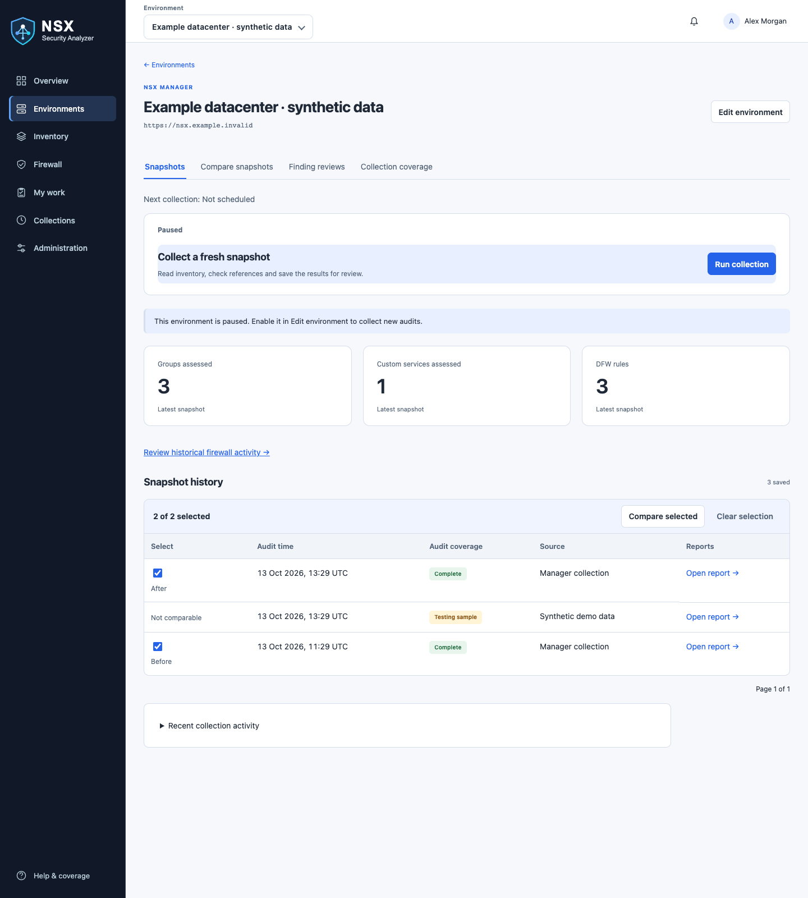
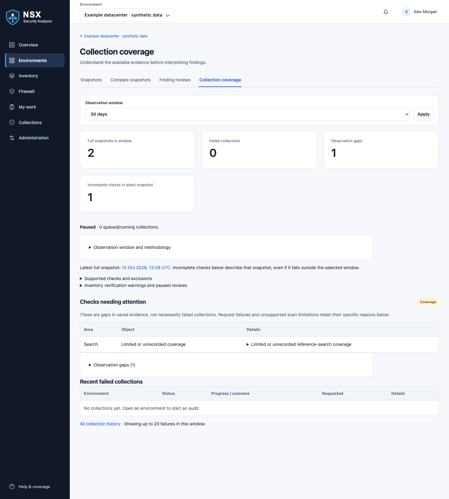
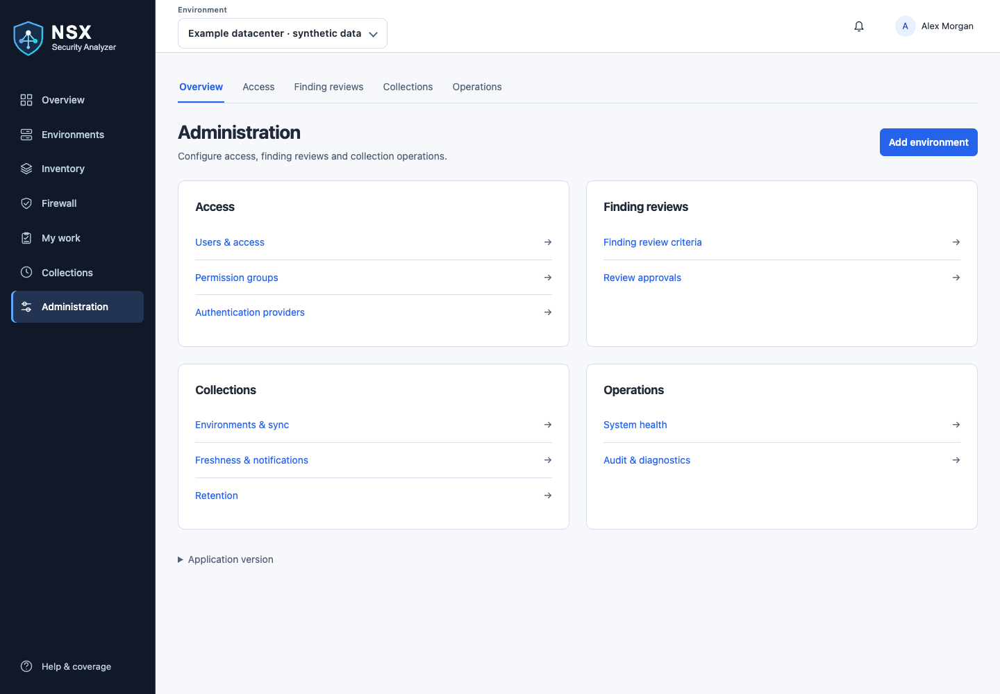

# Visual walkthrough

These are screenshots of the real **0.5.3** interface rendered locally with synthetic
users, environments, snapshots and findings. No production inventory, credentials or
live NSX connection was used. Synthetic full-snapshot and review fixtures were added
for documentation; the built-in demo normally uses testing snapshots, which cannot
be compared or used as operational review evidence.

Images use a desktop viewport and light theme. Your role, theme, screen size, saved
filters and review state can change the available controls. Click an image on GitHub
to view its full size. Screenshots illustrate appearance, not collection completeness
or approval of any real object.

## Find and review work

Open an environment → **Finding reviews**. Use queue tabs and filters to find work.
The Select column offers checkboxes only where you may return the assignment.

Open the finding name to inspect evidence, readiness and review progress. Follow the
[finding review guide](finding-review-workflow.md) for assignment, required checks,
independent approvals and manual completion.

## Return work to the queue

Select eligible rows → **Return to unassigned** → enter a reason → submit.
Valid approvals and history are preserved; the server rechecks permissions and revisions.

The **Unassigned** queue hides release controls. Open a finding and use
**Actions → Assign owner** to take responsibility.

## Compare saved evidence

Choose two eligible snapshots and select **Compare selected**. The earlier timestamp
is Before; the later is After. For other pairs, use the comparison selectors.
See [comparison and coverage](history-and-review.md) for eligibility and limitations.

## Check coverage

Review gaps, freshness and incomplete checks. Inventory-verification warnings can
pause finding evaluation and approvals even when a snapshot remains browsable.

## Administration

Administrators configure review approvals, authentication and operating policies.
Use [operations](operations.md) for diagnostic collections and troubleshooting.

## Screenshot maintenance

Captured on 13 October 2026 from main release code `e84d3f9`, including the
Unassigned selection fix. Assets are in `docs/images/` and shared across guides.
Recapture the affected page when its controls or navigation change. Use an isolated
synthetic database and a separate browser session; never capture a production
account, secret field, token, real Manager hostname or private inventory.
