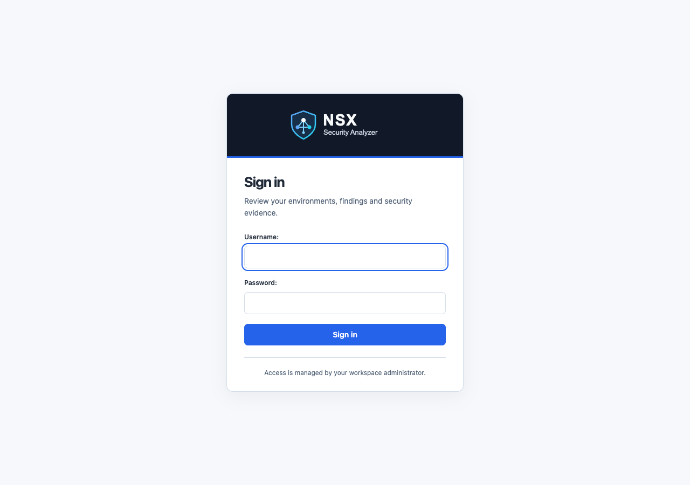
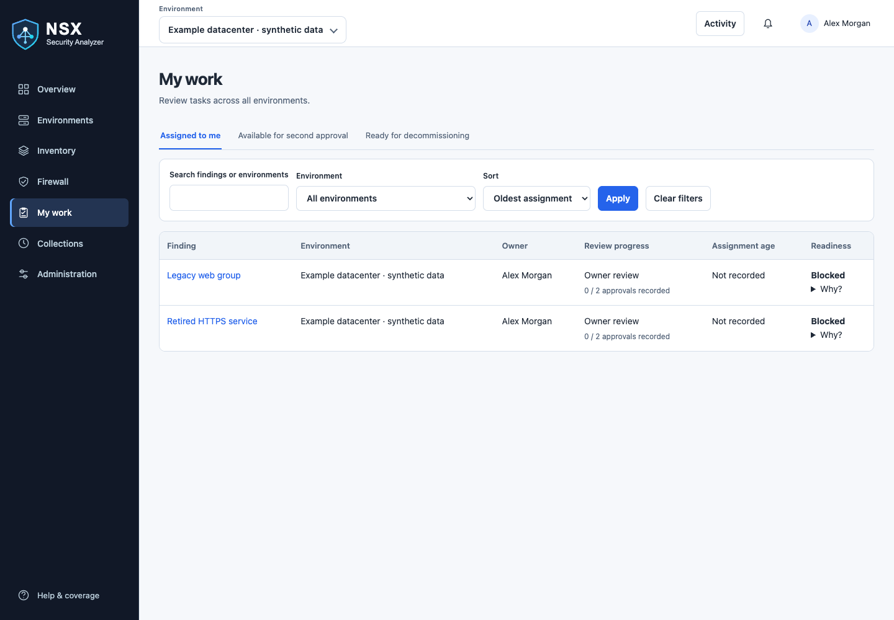
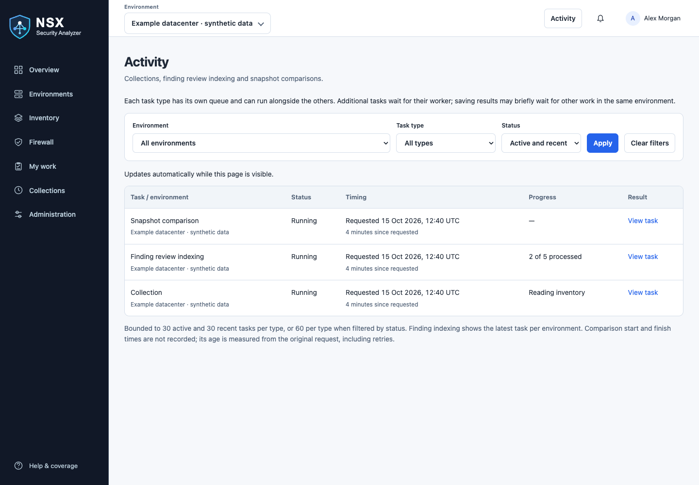
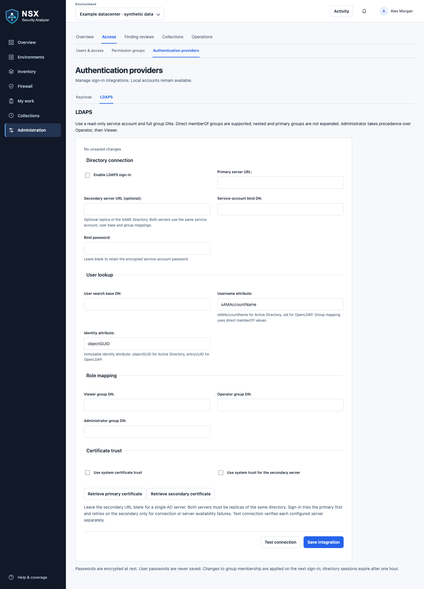

# Visual walkthrough

These are screenshots of the real **development interface (UI/UX batches 1–3)** rendered locally with synthetic
users, environments, snapshots and findings. No production inventory, credentials or
live NSX connection was used. Synthetic full-snapshot and review fixtures were added
for documentation; the built-in demo normally uses testing snapshots, which cannot
be compared or used as operational review evidence.

Images use a desktop viewport and light theme. Your role, theme, screen size, saved
filters and review state can change the available controls. Click an image on GitHub
to view its full size. Screenshots illustrate appearance, not collection completeness
or approval of any real object.

The images predate category-specific approval modes and confirmed NSX deletion.
For current controls and their behavior, see the [review workflow](finding-review-workflow.md#approval-modes-by-category)
and [deletion walkthrough](finding-review-workflow.md#using-the-deletion-preview).

## Sign in

Enter your local credentials, or choose Keycloak or LDAPS when your administrator
has enabled them. The LDAPS page uses the same branding and form layout.

## Find and review work

Open an environment → **Finding reviews**. Use queue tabs and filters to find work.
Selection controls appear only when an available bulk action applies to the queue.
Assignment and review progress are shown separately.

Open the finding name to inspect evidence, readiness and review progress. Follow the
[finding review guide](finding-review-workflow.md) for assignment, required checks,
independent approvals, manual completion and administrator-confirmed NSX deletion.

For badges such as **8 / 7 days · 192 observations**, see
[Reading observation badges](finding-review-workflow.md#reading-observation-badges).
Observations count successful checks, not traffic hits.

## Return work to the queue

Select eligible rows → **Return to unassigned** → enter a reason → submit.
Valid approvals and history are preserved; the server rechecks permissions and revisions.

The **Unassigned** queue hides release controls. Open a finding and use
**Assign owner** to take responsibility (under **Actions** when multiple actions are available). Search and select a reviewer in one field; unassigned work requires no assignment reason.

## Compare saved evidence

Choose two eligible snapshots and select **Compare selected**. The earlier timestamp
is Before; the later is After. For other pairs, use the comparison selectors.
See [comparison and coverage](history-and-review.md) for eligibility and limitations.

## Check coverage

Review gaps, freshness and incomplete checks. Inventory-verification warnings can
pause finding evaluation and approvals even when a snapshot remains browsable.

## Follow your work and background tasks

Use **My work** to filter assigned findings by environment and sort your queue.
Readiness explains why a finding can or cannot progress.

Open **Activity** in the top bar to follow collections, finding recalculations and
snapshot comparisons. Each task type has its own queue and result links.

## Administration

Administrators configure review approvals, authentication and operating policies.
Use [operations](operations.md) for diagnostic collections and troubleshooting.

Authentication forms group connection details, user lookup (LDAPS), role mapping
and certificate trust. Editing forms show unsaved changes and warn before leaving.
After validation fails, use the error summary links to reach the fields to correct.

## Screenshot maintenance

Captured on 15 October 2026 from the local development working tree, including
the three UI/UX batches. These screenshots may be ahead of the published image. Assets are in `docs/images/` and shared across guides.
Recapture the affected page when its controls or navigation change. Use an isolated
synthetic database and a separate browser session; never capture a production
account, secret field, token, real Manager hostname or private inventory.
